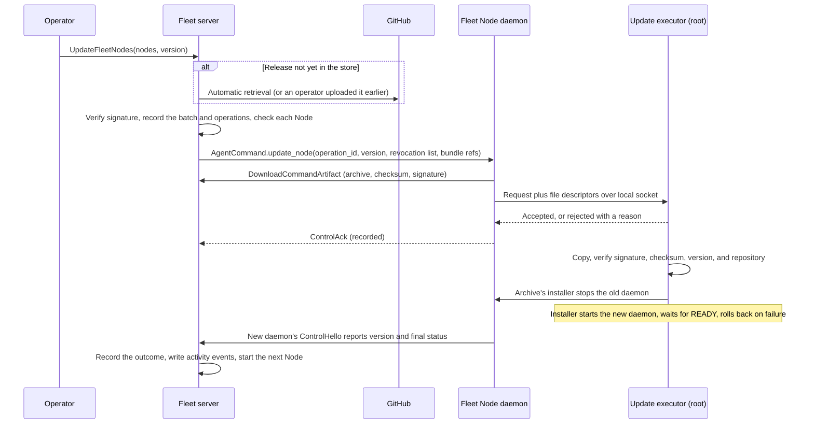
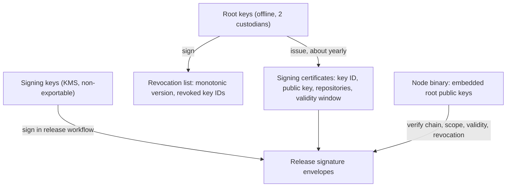

# RFC 0004: Fleet Node updates

- **Status**: draft
- **Author(s)**: Rongxin (@rl-block)
- **Created**: 2026-10-21
- **Last updated**: 2026-10-23

## Summary

Let an operator update Fleet Nodes from Fleet. Each Node gets updates from the Fleet server it's paired with, by default.

**Distribution.** The Fleet server is the central distribution point. It fills a release store in two ways:
- downloading Node releases from GitHub automatically
- accepting releases that operators upload

Nodes download from their paired server, never from GitHub. A Node's update source follows its enrollment automatically, so re-pairing a Node with another server also switches where it gets updates. An administrator can override the source on the host, but that should be uncommon.

**Installation.** Fleet sends a Node only an operation ID and an exact release version over the existing `ControlStream`. The unprivileged Fleet Node daemon downloads the release from the Node's update source and hands it to a small root-owned service. That service verifies the release signature and installs it with the existing transactional installer, which rolls back automatically if the new version doesn't start.

**Trust and records.** Every release is signed by the release pipeline. Neither the Fleet server nor the path a release travels can make a Node run code the pipeline didn't sign. Signing uses offline root keys and short-lived signing certificates, so keys can be rotated, routinely or in an emergency, under a procedure defined up front. Fleet keeps durable records of every release it stores and every update request, transition, and outcome, for audit and debugging.

This replaces the statement in [RFC 0001](0001-agent-server-split.md#fleet-node-updates) that self-update over the gateway is out of scope. It also delivers RFC 0001's planned signed Node release artifacts.

## Assumptions

- **Connectivity.** A Fleet Node can always reach its Fleet server, either directly on the same network or through the server's HTTPS endpoint, for example behind a load balancer. Fleet never opens connections to Nodes. Nodes already hold an outbound connection to their server, and they download release files through that same endpoint.
- **Fleet's reach.** The Fleet server can reach GitHub over HTTPS when automatic retrieval is used. A server without that access relies on manual upload.
- **Front-end limits.** Proxies, load balancers, and web application firewalls in front of Fleet may cap request sizes per path, time out idle connections, and rate-limit Node bootstrap RPCs per source IP. Several Nodes at one site can share a source IP.
- **HA storage.** In HA deployments, Fleet's file storage is local to each host and not replicated ([RFC 0002](0002-active-passive-fleet-ha.md)). The release store therefore can't rely on file storage alone.
- **Clocks.** Node clocks are correct, as authentication already requires.

## Decision summary

| Area | Direction |
| ---- | --------- |
| Trigger | Fleet API, used first by the Nodes page, gated by `fleetnode:manage`. The host installer remains the manual path. |
| What Fleet sends | An operation ID, an exact version, the current revocation list, and references to the bundle in its release store. Never a URL, repository, or script. |
| Update source | Default: the Fleet server the Node is enrolled with, derived from enrollment state with no stored URL. Re-pairing changes it automatically. Uncommon override: a static HTTPS mirror or a local directory, set in root-owned host configuration. Fleet can't change it remotely. |
| Distribution | Nodes download from their update source, never from GitHub. Fleet fills its release store by automatic retrieval from a configurable location, which defaults to the GitHub releases of its publishing repository, or by chunked manual upload. Bundles are stored in Fleet's database so every HA host can serve them, with a cache on each host. |
| Privilege boundary | The unprivileged daemon downloads; a root, socket-activated `fleet-node-update` service only verifies and installs, without network access. |
| Signing | Offline root keys embedded in Node binaries issue short-lived signing certificates scoped to a repository. Signing keys are held in a KMS. A root-signed revocation list covers compromise. |
| Key rotation | Routine signing-key rotation needs no Node update. Root rotation overlaps two roots across releases. Both have documented emergency procedures. |
| Version policy | A semantic version newer than the running release, from the same repository. No downgrades, nightlies, or repository switches. |
| Support signal | A dedicated `ControlHello` field, not a new command protocol version. |
| Success | The installer succeeds and the Node reconnects reporting the target version. Otherwise the update is "unconfirmed" after a timeout. No automatic rollback beyond the installer's start-time rollback. |
| Pacing | A canary Node first, then waves of up to 10 Nodes by default, adjustable per batch. Stop at the first failure and skip disconnected Nodes. Runs are stored in the database and resume after a Fleet restart or HA failover. |
| Records | Durable records of the release store, batches, operations, and events in Fleet's database; activity-log events for the organization's audit feed; update metrics for alerting; and a bounded local history on each host. |

## Motivation

Today a Fleet Node is updated by signing in to its host and running `install-fleet-node.sh` for an exact release, which downloads it from GitHub. Public documentation says "Fleet Node does not update itself." Deployments that run private release builds need a two-person procedure: someone with repository access downloads the release, and someone with host access installs it. Each Node host therefore needs operator shell access, and, unless files are staged, its own access to GitHub. Fleet has no view of update progress and no record of who updated which Node, when, or to what.

This doesn't scale. The public capacity guidance recommends up to 1,000 Fleet Nodes per Fleet server, and up to 2,000 for planning, so a single release can mean hundreds of host logins.

Fleet already holds a live, authenticated connection to every Node it manages. That makes it the natural place to manage updates centrally: it holds the releases, tells Nodes when to update, and records what happened. Nodes then need neither GitHub access nor operator shell access for routine updates.

Several building blocks now exist:

- `install-fleet-node.sh --release-dir DIR VERSION` installs operator-staged files with the same checksum, manifest, version, and repository checks and the same rollback as a download (block/proto-fleet#1108).
- Node binaries embed their release version and publishing repository. They expose these through `fleetnode --version` and `fleetnode --print-release-repository`, and log them at startup.
- Nodes report their version on heartbeats, and the Nodes page shows it.
- Fleet already flags Nodes whose command protocol is behind the server's, but it can't act on that.
- Fleet already downloads release metadata from GitHub for its own update checks.
- Fleet already serves files to Nodes through `DownloadCommandArtifact`, for example miner firmware.

Some deployments run release builds from a private fork, which Nodes can't download anonymously. Uploading such a release once to Fleet, which then distributes it, replaces staging files on every host.

The goals follow the acceptance criteria of the public issue (block/proto-fleet#1104), plus an audit requirement:

1. A repeatable way to update Fleet Nodes to a selected release.
2. Reporting of update progress, failures, and the version running after each update.
3. Documentation of the update workflow and of recovery from a failed update.
4. A durable record of every update for audit and debugging.

Non-goals:
- zero-downtime replacement (the warm-standby design in RFC 0001 Phase 6 isn't built)
- updating plugins on their own
- Windows and Docker development Nodes
- repository switches and downgrades
- updates that start without an operator request

## Detailed design

### Flow



### Release identity

Phase 1 builds on the identity that already exists:
- the stamped `main.version` and `releaseinfo.Repository`
- the heartbeat `version` field
- the version shown on the Nodes page

The heartbeat value stays the display source for disconnected Nodes. `ControlHello` also carries the version, repository, and architecture so that Fleet's checks at dispatch time use the identity of the live connection, and Fleet knows which architecture's bundle to send. A heartbeat-persisted value can lag a reconnect by up to one heartbeat interval.

### Update source

**Default.** A Node's update source is its paired Fleet server. The daemon derives this from the `server_url` it already stores at enrollment. There's no separate update URL to configure, store, or hardcode, and the codebase contains no default download location for Nodes. Re-pairing with `fleetnode-enroll --force` replaces `server_url`, so the update source follows without any extra step.

**Override.** An administrator can set `update-source` in `/etc/fleetnode/config.yaml`, which the daemon already loads. The file is root-owned and read-only to the service. It accepts two forms:
- `https://<mirror>/<path>`: a static mirror using the GitHub release layout, `<base>/<version>/fleetnode-<version>-linux-<arch>.tar.gz` plus its `.sha256` and `.sig`.
- `file:///<directory>`: a local directory with the same layout, readable by the `fleetnode` account and outside `/home`. The service runs with `ProtectHome=true`, so it can't see home directories.

Overrides are expected to be uncommon; re-pairing is the simpler way to move a Node to another server.

**Remote control.** Fleet can't change a Node's update source. `ControlHello` reports the effective source as `fleet`, `mirror`, or `local`, without the URL. Fleet shows it on the Nodes page and includes bundle references in the update command only when the source is `fleet`.

**Why this is safe.** Releases are verified against pipeline signatures on the Node. So where a Node downloads from affects whether the files are available, not whether they're trusted. The publishing repository a Node accepts stays fixed at build time, and the repository rules from block/proto-fleet#1046 are unchanged.

### Fleet release store

The release store holds signed Node bundles: an archive, `.sha256`, and `.sig` for each architecture. Bundles arrive in two ways:

- **Automatic retrieval.** When an operator requests a version the store doesn't have, Fleet downloads it for the architectures its Nodes report. It downloads the same files as the Fleet installer does. The location is configurable in Fleet's settings: it defaults to the GitHub releases of Fleet's publishing repository, using the same repository identity as Fleet's own update checks, and it can point at a mirror or be turned off. Fleet can also prefetch the release matching its own version after it upgrades. Retrieval makes unauthenticated requests, so private repositories use upload.
- **Manual upload.** Operators upload one architecture's bundle at a time through the UI or the API. Uploads use the chunked upload flow Fleet already uses for miner firmware, so each request stays within the per-request size limits common in front-end proxies.

  Automation can drive the same API with a Fleet API key. Running it inside the deployment, for example on a Fleet host, keeps it clear of front-end restrictions meant for people, such as IP allowlists. A pipeline can download a private release with its own GitHub credentials and upload it; Fleet servers and Nodes never need GitHub credentials.

Fleet verifies every bundle's signature, version, repository, and architecture before accepting it, and records where it came from and who supplied it. The upload and retrieval-settings APIs are gated by `fleetnode:manage`.

**Storage.**
- **Database:** the authoritative copy of each accepted bundle is stored in Fleet's database in fixed-size chunks. In HA deployments the database is already replicated, so whichever host is active can serve every stored release, including uploads, after a failover. The host that received an upload doesn't need to stay active.
- **Host cache:** each host keeps a file cache of bundles it has served, checked against the recorded digest. The cache is rebuilt from the database whenever it's missing or stale, and it stays within the host's free-space reservations.
- **Size:** stored bundles take about 45 MiB per release and architecture.
- **Retention:** by default the store keeps every release still installed on a Node, plus the three newest releases. Removing a release is a recorded operator action.

### Release signing

**What is signed.** For each Node archive, the release pipeline produces `fleetnode-<version>-linux-<arch>.tar.gz.sig`. It's a DSSE-style envelope: a typed payload plus signatures, so no JSON canonicalization is needed. The payload is a statement:

```json
{
  "type": "proto-fleet/fleet-node-release/v1",
  "artifact": "fleetnode-v0.6.0-linux-arm64.tar.gz",
  "sha256": "<archive digest>",
  "version": "v0.6.0",
  "release_repository": "block/proto-fleet",
  "arch": "arm64"
}
```

Binding the version and repository into the statement stops a signed archive being replayed as a different version, or into another repository's Nodes. Each envelope carries its signing certificate, so verification needs no network access.

**Key hierarchy.**



- **Root keys.** Each root key is held offline by two custodians, for example on hardware tokens. They're used only in short signing ceremonies to issue signing certificates and revocation lists. Each Node release embeds a keyring of one or two root public keys at build time, the same way it embeds `releaseinfo.Repository`.
- **Signing keys.** Signing keys live in a cloud KMS and are never exported. The release workflow reaches them through GitHub OIDC, restricted to release and nightly workflows on protected refs. Algorithm: Ed25519 where the KMS supports it, otherwise ECDSA P-256. Both verify with the Go standard library, so the Node needs no new dependency.
- **Signing certificates.** Each certificate names its key ID, public key, the repositories it may sign for, and a validity window of about 13 months. The root key signs it. The repository scope means a fork's signing key can't sign releases for upstream Nodes, and the reverse.
- **Revocation list.** A small root-signed document carrying a monotonic version and the revoked signing key IDs. Each release attaches the current list, and Fleet sends it with every update command. A Node keeps the highest-versioned list it has seen and never accepts an older one.

**Verification.** The executor verifies every release before installing it, whichever source the release came from. It checks that:
- the certificate chains to a root in the Node's keyring
- the certificate is within its validity window at the Node's current time
- the certificate's scope includes the Node's pinned repository
- the key isn't revoked
- the signature covers the statement
- the statement's digest, version, repository, and architecture match the archive and the request

Fleet runs the same verification when a bundle enters its store, so mistakes surface early, but Nodes never rely on Fleet having checked. Releases that predate signing can't be installed through the executor.

**Manual installs.** `install-fleet-node.sh` keeps its current checksum and repository checks. When an existing installation's binary supports it, the installer also verifies the new release with `fleetnode release verify` from the *installed* binary before replacing it. Fresh installs keep HTTPS and the checksum as their trust anchor.

### Key rotation

| Event | Procedure | Node impact |
| ----- | --------- | ----------- |
| Routine signing-key rotation (yearly, or when custodians or KMS settings change) | Create a new KMS key. Hold a root ceremony to issue its certificate, then switch the pipeline. Before the old certificate expires, re-sign all supported releases with the new key. Signature files are separate assets, so archives and checksums don't change. Fleet picks up new signatures by retrieval or upload. | None. |
| Signing-key compromise | 1. Pause distribution and ingest in Fleet. 2. Root custodians publish a revocation list naming the key. 3. Issue a new signing key and certificate. 4. Re-sign supported releases. 5. Resume distribution. 6. Use the durable records to list every update installed under the revoked key, and review those Nodes. | Nodes reject the revoked key from their next update command, because every command carries Fleet's current list and the executor adopts a newer list before verifying. A Node installs nothing through the executor without a command, so idle Nodes are covered too. Releases also attach the list for manual installs. |
| Planned root rotation (every few years, or when custodians change) | 1. Release N embeds the old and new root keys. 2. Once Fleet reports that every active Node trusts the new root, issue certificates only from it. 3. A later release drops the old root. | One ordinary update, to release N or later. Fleet blocks releases signed only under the new root for Nodes that don't trust it yet, and shows them as needing an update. |
| Root compromise | Pause distribution. Publish a release embedding a new root, signed under it, and install it manually on each Node through the installer's HTTPS download or a staged directory. Resume distribution per Node once it reports the new root. | A manual update on every Node. Offline custody and the narrow ceremony scope keep this unlikely. |

`ControlHello` reports each Node's trusted root key IDs and revocation list version, so Fleet can show which Nodes are ready for a rotation before it starts. Certificate checks depend on the Node's clock; a clock error is reported as a signature failure with the reason. Every signing ceremony and rotation is recorded in a runbook kept alongside the release workflow. At least one rotation drill runs in CI before phase 1 ships.

### Update executor

**Packaging.** The Node archive gains three files:
- a repository-stamped `install-fleet-node.sh`, covered by the archive checksum and signature
- `fleet-node-update.socket`
- `fleet-node-update.service`

The installer's manifest allowlist accepts them. Install, rollback, and uninstall handle the two units, and installation enables the socket. Older installers reject archives with the new files, which only matters when someone runs an old installer against a new release. The documented manual flow always uses the target release's own installer.

**Units.**
- **Socket:** `fleet-node-update.socket` listens on `/run/fleetnode-update/update.sock` with `SocketUser=root`, `SocketGroup=fleetnode`, and `SocketMode=0660`.
- **Service:** `fleet-node-update.service` runs `fleetnode update-executor` as root, outside `fleet-node.service`. That matters because the installer stops `fleet-node.service`. The service exits when idle. It runs with `PrivateNetwork=yes`, because it never downloads anything; the daemon does.
- **Daemon unit:** unchanged. Its existing `AF_UNIX` allowance should be enough to connect to the socket; native qualification must confirm this under `ProtectSystem=strict`.

**Fetching.** The daemon downloads the archive, checksum, and signature into its spool directory under `/var/lib/fleetnode`:
- **Paired server (default):** through `DownloadCommandArtifact`, using the references in the update command and the daemon's existing session.
- **Override:** from the configured mirror or local directory.

It then sends the executor the request and open file descriptors for the three files.

**Requests.** One JSON object per connection, at most 64 KiB, with the file descriptors passed alongside. It contains:
- the operation ID
- the target version
- Fleet's current revocation list

The executor never reads a URL, path, repository, or command from a request. It accepts a request only when all of these hold:

- `operation_id` is a canonical UUID.
- `target_version` matches the installer's tag grammar, is a valid semantic version, and is newer than the installed `/opt/fleetnode/version.txt`. Nightly tags aren't semantic versions, so they're rejected.
- The installed `version.txt`, the installed binary's embedded repository, and `/etc/fleetnode/release-repository` (when present) all name the same repository. A mismatch is reported as `REPOSITORY_MISMATCH`.
- No other operation is active. Repeating an operation ID returns that operation's current status rather than starting a new one.

**Installation.** The executor:
1. Copies the three files from the descriptors into a private, root-only directory, so the daemon can't change them after verification.
2. Adopts the revocation list if it's newer than the stored one, then verifies the signature as described under *Release signing*.
3. Checks that the checksum file names the archive, verifies the checksum, and extracts the archive.
4. Confirms the archive's `version.txt` matches the signed statement.
5. Runs the archive's own installer with `--release-dir` pointing at the private copy.

The installer then performs its existing transactional replacement: stop, replace, start, wait for systemd readiness, and roll back on failure.

**Status and local history.** `/var/lib/fleetnode-update/status.json` lives in a root-owned `0755` directory as a `0644` file, so the daemon can read it but not write it. It records:
- operation ID
- target version
- previous version
- source
- archive digest
- signing key ID
- phase
- error
- timestamps
- outcome revision

The phases reuse `instance.v1.UpgradePhase` names: `QUEUED`, `DOWNLOADING`, `VERIFYING`, `STAGING`, `ACTIVATING`, `SUCCEEDED`, and `FAILED`, plus `ROLLED_BACK`. The daemon reports `DOWNLOADING` itself before it hands off. On startup, the executor reconciles an operation interrupted in `ACTIVATING` from the installed `version.txt`.

Each finished operation is also appended to `/var/lib/fleetnode-update/history.jsonl`, which keeps the most recent 200 entries, and logged to the journal. This lets someone on the host debug an update even when Fleet is unreachable. The revocation list is stored beside them as `revocations.json`.

**Bootstrap.** A Node running a release without the executor needs one manual update to a signed release that has it.

### Gateway contract

```proto
message ControlHello {
  CommandProtocolVersion max_command_protocol_version = 1;
  // Running binary's release version, publishing repository, and architecture.
  string version = 2 [(buf.validate.field).string.max_len = 128];
  string release_repository = 3 [(buf.validate.field).string.max_len = 140];
  string arch = 4 [(buf.validate.field).string = {in: ["amd64", "arm64"]}];
  NodeUpdateState update = 5;
}

message NodeUpdateState {
  // True only when the root update executor is installed and reachable.
  bool executor_available = 1;
  NodeUpdateUnavailableReason unavailable_reason = 2;
  NodeUpdateOperation last_operation = 3;
  repeated string trusted_root_key_ids = 4;
  uint64 revocation_list_version = 5;
  // Effective update source; the URL itself is never reported.
  NodeUpdateSource source = 6;
}

enum NodeUpdateSource {
  NODE_UPDATE_SOURCE_UNSPECIFIED = 0;
  NODE_UPDATE_SOURCE_FLEET = 1;
  NODE_UPDATE_SOURCE_MIRROR = 2;
  NODE_UPDATE_SOURCE_LOCAL = 3;
}

message NodeUpdateOperation {
  string operation_id = 1;
  string target_version = 2;
  string previous_version = 3;
  NodeUpdatePhase phase = 4;
  string error = 5;
  NodeUpdateSource source = 6;
  string artifact_sha256 = 7;
  string signing_key_id = 8;
  uint64 outcome_revision = 9;
  google.protobuf.Timestamp started_at = 10;
  google.protobuf.Timestamp updated_at = 11;
  google.protobuf.Timestamp completed_at = 12;
}

message UpdateFleetNodeRequest {
  string operation_id = 1 [(buf.validate.field).string.uuid = true];
  string target_version = 2 [(buf.validate.field).string = {min_len: 1, max_len: 128}];
  // Root-signed revocation list; the Node keeps the highest version it has verified.
  bytes revocation_list = 3 [(buf.validate.field).bytes.max_len = 65536];
  // Present when the Node's source is its paired server.
  ReleaseArtifacts artifacts = 4;
}

message ReleaseArtifacts {
  CommandArtifactRef archive = 1;
  CommandArtifactRef checksum = 2;
  CommandArtifactRef signature = 3;
}

// New AgentCommand arm.
//   UpdateFleetNodeRequest update_node = 6;

// New CommandArtifactPurpose value, admitted only for an in-flight update_node command.
//   COMMAND_ARTIFACT_PURPOSE_FLEET_NODE_RELEASE = 3;

// New UploadHeartbeatRequest field: the active operation while the old daemon runs.
//   NodeUpdateOperation update = 4;
```

The daemon validates the command, fetches the bundle from its update source, forwards the request to the executor socket, and acknowledges it once the executor accepts or rejects it. A rejection maps to an existing `AckCode` with the executor's reason. Bundle downloads use the existing command-artifact admission: the gateway serves the release files only for the in-flight `update_node` command that referenced them, to the Node it was sent to. The daemon downloads before it acknowledges, so `update_node` gets a dispatch timeout long enough to download about 45 MiB.

Fleet dispatches only to connections whose `ControlHello` reports `executor_available` and trust in the root that issued the target release's signing certificate. When the Node's source is `fleet`, the store must also hold the bundle for the Node's architecture. The command protocol enum is unchanged: update support depends on whether the executor is installed, not only on daemon code, and keeping it off the enum leaves that enum to miner commands.

### Update records

Fleet keeps durable records in four tables, plus one table that holds bundle contents, all added by a new migration. Batches are stored even for a single Node, so every operation has the same shape.

```sql
CREATE TABLE fleet_node_release (
  id bigserial PRIMARY KEY,
  org_id bigint NOT NULL,
  version text NOT NULL,
  arch text NOT NULL,
  release_repository text NOT NULL,
  artifact_sha256 text NOT NULL,
  signing_key_id text NOT NULL,
  origin text NOT NULL,            -- retrieved, uploaded
  supplied_by bigint REFERENCES "user"(id),
  created_at timestamptz NOT NULL,
  removed_at timestamptz,
  removed_by bigint REFERENCES "user"(id)
);

-- Bundle contents (archive, checksum, signature) in fixed-size chunks.
-- Rows are deleted when a release is removed; the release record above remains.
CREATE TABLE fleet_node_release_chunk (
  release_id bigint NOT NULL REFERENCES fleet_node_release(id),
  file text NOT NULL,              -- archive, checksum, signature
  seq integer NOT NULL,
  data bytea NOT NULL,
  PRIMARY KEY (release_id, file, seq)
);

CREATE TABLE fleet_node_update_batch (
  id uuid PRIMARY KEY,
  org_id bigint NOT NULL,
  requested_by bigint REFERENCES "user"(id),
  target_version text NOT NULL,
  status text NOT NULL,            -- running, completed, stopped, canceled
  created_at timestamptz NOT NULL,
  updated_at timestamptz NOT NULL,
  completed_at timestamptz
);

CREATE TABLE fleet_node_update (
  operation_id uuid PRIMARY KEY,
  org_id bigint NOT NULL,
  fleet_node_id bigint NOT NULL,
  batch_id uuid NOT NULL REFERENCES fleet_node_update_batch(id),
  position integer NOT NULL,
  target_version text NOT NULL,
  previous_version text,
  release_repository text NOT NULL,
  source text,                     -- fleet, mirror, local
  release_id bigint REFERENCES fleet_node_release(id),
  artifact_sha256 text,
  signing_key_id text,
  revocation_list_version bigint,
  status text NOT NULL,            -- pending, dispatched, in_progress, succeeded, failed,
                                   -- rolled_back, unconfirmed, rejected, skipped, canceled
  phase text,
  error_code text,
  error_message text,
  reported_version text,
  node_outcome_revision bigint,
  created_at timestamptz NOT NULL,
  updated_at timestamptz NOT NULL,
  completed_at timestamptz,
  CONSTRAINT fk_fleet_node_update_node FOREIGN KEY (fleet_node_id, org_id) REFERENCES fleet_node(id, org_id)
);

CREATE TABLE fleet_node_update_event (
  id bigserial PRIMARY KEY,
  operation_id uuid NOT NULL REFERENCES fleet_node_update(operation_id),
  org_id bigint NOT NULL,
  occurred_at timestamptz NOT NULL,
  origin text NOT NULL,            -- fleet, node
  status text NOT NULL,
  phase text,
  message text,
  details jsonb                    -- bounded, never credentials
);
```

- **Writes.** Fleet records each release when it enters the store. It records the batch and every operation before it dispatches anything. It appends an event for each transition: dispatch, acknowledgement, every phase from heartbeats, reconnect, and the final outcome. Writes are idempotent on operation ID and the Node's outcome revision. The Node's status file stays authoritative for what happened on the host: on reconnect, Fleet reconciles any outcome it missed, for example after a Fleet restart.
- **Retention.** Records are kept when a Node is revoked or deleted, or a release is removed from the store. Fleet Nodes are soft-deleted, and the tables never cascade deletes. Records are kept indefinitely in phase 1; a pruning policy can follow if volume requires it.
- **Audit feed.** Fleet also writes activity-log events for releases added and removed, and for update batches requested and completed, using the batch ID the activity log already supports. Update activity then appears alongside other operator actions, and the detailed records hold the timeline.
- **Access.** `ListFleetNodeReleases`, `ListFleetNodeUpdates` (by Node, batch, or time range), and `GetFleetNodeUpdate` (an operation with its events) are gated by `fleetnode:read`. Records never contain credentials or override URLs, and bundle contents are reachable only through the release store.
- **Metrics.** Fleet exports update counts by outcome, durations by phase, and the number of Nodes behind Fleet's version, plus structured logs keyed by operation ID. Deployments can then alert on failed or unconfirmed updates and on Nodes left behind.

### Fleet API and UI

`FleetNodeAdminService.UpdateFleetNodes` takes Node IDs and an exact target version, and returns the batch ID with an operation ID for each Node. It's gated by `fleetnode:manage`. For each Node, Fleet requires:
- an active `ControlStream`
- `executor_available`
- a `release_repository` that equals Fleet's own `releaseinfo.Repository`
- a target newer than the Node's running version
- trust in the target release's signing root

When the Node's source is `fleet`, the store must also hold a verified bundle for the Node's architecture. If it doesn't, Fleet retrieves it when automatic retrieval is enabled. A Node that fails a check is recorded as `rejected` with the reason, for example "release not uploaded". The UI defaults the target to Fleet's own version, and operators can choose another exact tag that the store holds or can retrieve.

`ListFleetNodes` adds `update_available`, `update_unavailable_reason`, the effective update source, and the latest operation, using `FleetNodeSummary` field numbers 16 and above.

**Pacing.** The batch runner runs on the active Fleet instance:
- **Canary:** it updates the first Node alone, and continues only after that Node succeeds.
- **Waves:** it then updates up to 10 Nodes at a time by default. Operators can lower or raise this per batch, up to a server-wide maximum.
- **Stopping:** the run stops starting new updates at the first failed or unconfirmed Node. Updates already in progress finish and are recorded.
- **Disconnected Nodes:** a Node that is disconnected when its turn comes is recorded as `skipped`.

One Node at a time would take a day or more for a server with 1,000 Nodes; waves keep a large batch to hours. Waves also bound the load on Fleet and on sites where many Nodes share bandwidth or a source IP: at the default size, Fleet serves at most about 450 MiB at once. An updated daemon reuses its stored session, so a restart doesn't normally repeat the Node bootstrap RPCs that deployments may rate-limit.

Because batches and operations are stored, a new active instance resumes a running batch after a restart or HA failover. Operation IDs are created when the batch is recorded, so a resumed dispatch can't start a second update on a Node.

**Outcomes.**
- **Succeeded:** the Node reconnects with `ControlHello.version` equal to the target and `last_operation.phase` of `SUCCEEDED`.
- **Failed:** the Node reports `FAILED` or `ROLLED_BACK`.
- **Unconfirmed:** the Node doesn't reconnect within 10 minutes of `ACTIVATING`.

**UI.**
- **Releases:** a Node releases page lists the store with each release's source, uploader, digest, and signing key. It offers upload, retrieval settings, and removal.
- **Nodes page:** a row action and multi-select. The confirmation names the target version and warns about the short telemetry and command gap.
- **Progress:** shows the current phase.
- **Failures:** show the error, the recovery command, and `journalctl -u fleet-node-update.service`.
- **History:** each Node's details include its update history and effective update source. A batch view shows each Node's position and outcome.

### Repository pin repair

A Node whose program was replaced outside the installer can end up with a `version.txt` and binary from one repository, and a `release-repository` pin from another. The executor reports `REPOSITORY_MISMATCH` for such Nodes.

A new installer action, `install-fleet-node.sh repair-repository-pin`, rewrites the pin only when the installed `version.txt` and the installed binary both name the installer's packaged repository. It never changes the installed program. Moving a Node between repositories, for example from upstream releases to a fork's, remains a planned maintenance procedure.

### Security

- **Compromised Fleet server.** It can distribute only releases the pipeline signed, newer than each Node's version, for that Node's repository. It can't run arbitrary code. Because versions only move forward, it can cause at most a finite number of restarts. It can't roll back a Node's revocation list or change a Node's update source.
- **Untrusted delivery path.** Mirrors, local directories, Fleet's storage, and the daemon's spool are all untrusted: integrity comes only from signature verification inside the executor. The executor runs without network access and verifies copies it owns.
- **Compromised signing key.** On its own, it has no way to deliver a release. An attacker also needs a compromised Fleet server, write access to a Node's configured mirror, or root on the host. Non-exportable KMS keys, OIDC limited to release workflows, certificates of about 13 months, and revocation all bound the exposure. The durable records identify every Node that installed a release signed with the key.
- **Compromised root key.** This is the worst case and needs manual reinstallation (see *Key rotation*). Offline custody by two people and ceremony-only use keep it unlikely.
- **Untrusted input.** The executor caps request size, parses requests strictly, never invokes a shell with request data, and takes no paths or URLs from requests. Status and history are written only to root-owned locations.
- **Credential isolation.** Verifying before installing preserves RFC 0001's credential isolation: Fleet never gets a way to run code that could read a Node's credential key.
- **No GitHub credentials.** Neither Nodes nor Fleet servers hold GitHub credentials.

### Failure behavior

| Situation | Result | Recovery |
| --------- | ------ | -------- |
| The store lacks the release, and retrieval is off or fails | The Node's operation is `rejected` before dispatch, with the reason | Upload the release, or fix the retrieval settings or connectivity |
| An uploaded or retrieved bundle fails verification | Fleet rejects it on ingest and records why | Upload the correct, signed files |
| Signature invalid, key revoked, certificate expired, or root not trusted, on the Node | `FAILED` with `SIGNATURE_INVALID` and the reason, before the service stops | Re-sign the release, update the revocation list, fix the Node's clock, or update the Node manually to a release trusting the new root |
| Download from the update source fails, or the checksum doesn't match | `FAILED` before the service stops; nothing changes | Fix the source and retry with a new operation ID |
| New version doesn't start | Installer rolls back; `ROLLED_BACK`; previous version running | Inspect the logs and history; choose another release |
| Rollback also fails | `FAILED` with the rollback error; the Node may be down | On the host, install the previous release with `--release-dir` |
| Starts but doesn't reconnect | `UNCONFIRMED` | Inspect the host journal and history; reinstall the previous release |
| Executor or host restarts mid-update | Executor reconciles the status from `version.txt` on its next start | None, or as above |
| Fleet restarts or fails over during a batch | A new active instance resumes the batch and serves bundles from the database, rebuilding its cache as needed; Fleet reconciles missed outcomes when Nodes reconnect | None |

### Validation gates

- **Signing:**
  - tampered archive, wrong repository scope, wrong architecture, and version mismatch
  - expired and not-yet-valid certificates, revoked key, unknown root, and an older revocation list
  - a CI rotation drill that signs with a second key and later a second root
- **Update source:**
  - the default derives from `server_url` and follows re-pairing
  - overrides parse and are restricted to root-owned configuration
  - Fleet can't change the source
- **Release store:**
  - automatic retrieval, chunked upload, and rejection on ingest
  - retention, and the release records
  - cache rebuild from the database
  - after an HA failover, the new active host serves a release uploaded to the old one
- **Front end:**
  - a chunked upload through a proxy that caps requests at 64 MiB
  - a release download through a load balancer with an idle timeout
  - an update wave from Nodes sharing one source IP that stays within bootstrap rate limits
- **Executor:** unit tests for request parsing, descriptor handling, version policy, repository checks, status, and history.
- **Installer harness:** the new units, the manifest allowlist, and verification with the installed binary.
- **Native qualification (amd64 and arm64):**
  - install signed release N, then update to N+1 through the socket from Fleet, a mirror, and a local directory
  - inject a broken candidate and expect `ROLLED_BACK`
  - interrupt the executor and expect reconciliation
  - confirm the executor has no network access
- **Database:** migration tests; idempotent record writes; a batch resuming after a simulated failover.
- **Scale:** a batch across hundreds of simulated Nodes with the default wave size, measuring duration, Fleet throughput, and database load.
- **Fleet:** gateway, registry, and admin handler tests, including permissions, plus releases, Nodes page, and history tests.
- **Manual:** a physical Raspberry Pi and an amd64 VM, paired with a Fleet server, updated through the Nodes page using both retrieved and uploaded releases.

## Drawbacks

- **More root code:** every Node gets a root component to secure and maintain.
- **Key operations:** root custody, ceremonies, KMS configuration in two repositories, re-signing before certificates expire, and rotation drills are ongoing work.
- **Load on Fleet:** Fleet serves every Node's download through the gateway. Waves bound this to about 450 MiB at a time at the default size.
- **Database size:** the database holds stored bundles, about 45 MiB per release and architecture, bounded by store retention. They also add to database backups and replication traffic.
- **Clock dependency:** certificate checks need a correct clock on the Node.
- **Bootstrap:** existing Nodes need one manual update to the first signed release with the executor.
- **Downtime:** each update interrupts telemetry and commands for that Node's miners briefly.
- **Migration:** a new migration and records that are kept indefinitely.

## Alternatives considered

- **Nodes download directly from GitHub.** Every Node needs GitHub access, private releases can't work without credentials on hosts, and update management stays scattered across hosts.
- **An update URL configured on each Node at install time.** It duplicates the enrollment server, drifts when a Node is re-paired, and adds a setting most deployments never need.
- **Fleet configures each Node's update source remotely.** A compromised Fleet could redirect every Node. Signatures would still protect integrity, but Nodes could be denied updates or sent to arbitrary hosts.
- **Operator tooling only** (SSH scripts around the installer). It needs shell access to every host, gives no central progress, and keeps no audit trail.
- **The daemon replaces itself.** This needs write access to `/opt/fleetnode` and service control for the `fleetnode` user, undoing its hardening.
- **Fleet distributes unsigned bundles.** Fleet would choose code that runs as root on every Node.
- **One long-lived signing key embedded in Nodes.** Every rotation needs a coordinated Node update, and recovering from a compromise is slow.
- **Sigstore keyless signing with the public transparency log.** Private repository identities and artifact digests would be published publicly. Nodes would also need a trust root that changes over time, plus offline inclusion proofs.
- **GitHub artifact attestations.** Verifying them needs GitHub's API or trust root, which Nodes don't have.
- **GitHub credentials on Fleet servers** for retrieving private releases. That puts long-lived credentials on servers; upload covers private releases without them (see *Unresolved questions*).
- **Activity log as the only record.** It's a good audit feed but lacks structured per-operation state and phase timelines for debugging.
- **Gate on `CommandProtocolVersion`.** Support depends on the installed executor, not only on daemon code. Forks can also extend the command protocol independently, so version numbers aren't comparable across them.
- **Store bundles in host-local file storage, as firmware is.** In HA deployments, an uploaded release would be missing on the other host after a failover, and resumed batches would stall (RFC 0002).
- **Replicate bundles between HA hosts, or require shared object storage.** Replication needs a new transfer channel between hosts. Shared object storage only exists in some environments.
- **Strictly sequential batches.** Simple, but far too slow at the Node counts a single server is sized for.
- **Reuse the firmware rollout engine.** It's built around miner release channels, model groups, and per-device provenance, which is far heavier than Nodes need.

## Unresolved questions

1. Key custody: which KMS holds the signing keys, which hardware holds the root keys, and who the root custodians are.
2. Roots: one root shared by every publishing repository, for example upstream and a fork, with repository-scoped certificates? Or a separate root for each repository?
3. Is a 13-month certificate lifetime with yearly rotation right?
4. Should Fleet support credentialed retrieval of private releases, for example a read-only token in Fleet's settings, or is upload enough?
5. Should Fleet prefetch the release matching its own version after it upgrades, and how many releases should the store keep?
6. Should pin repair be an installer action, or a documented manual fix?
7. Is 10 minutes the right unconfirmed timeout, and should a Node that never reconnects roll back automatically? The proposed default is no.
8. Should targets newer than Fleet's own version be allowed? The proposed default is yes, when an operator selects them and the store holds them.
9. How long should records be retained, and should events be pruned before operations?
10. Should `fleetcli` expose updates, uploads, and history in phase 1?
11. Is storing bundles in the database acceptable for backup size and replication load? The alternatives are replication between HA hosts or optional shared object storage.
12. What default wave size and server-wide maximum should batches use, and should waves also be limited per site or per shared source IP?

## Phased rollout

- **Phase 0, done.**
  - **Goal:** safer manual updates and visible Node identity.
  - **Scope:** staged installs, plus version and repository identity with heartbeat version reporting.
  - **Behavior change:** operators can install without GitHub access and see Node versions on the Nodes page.
- **Phase 1a: signing.**
  - **Goal:** every release can be verified offline.
  - **Scope:** root ceremony and signing keys; signing in release and nightly workflows; the verification library and `fleetnode release verify`; revocation list publishing; the rotation runbook and CI drill. This can start immediately.
  - **Behavior change:** releases gain `.sig` assets, and the installer verifies upgrades with the installed binary when it can.
- **Phase 1b: executor.**
  - **Goal:** a local, privileged, verifying install path.
  - **Scope:** the executor and units, daemon fetching from a local-directory override for testing, packaging, installer changes, local history, and native qualification.
  - **Behavior change:** signed releases include the executor; nothing triggers it remotely yet.
- **Phase 1c: distribution.**
  - **Goal:** Fleet distributes releases.
  - **Scope:** the release store with automatic retrieval and upload; `ControlHello` identity, architecture, capability, trust state, and source; the `update_node` command; the release artifact purpose; heartbeat progress; the mirror override.
  - **Behavior change:** roll out Nodes first. Older Fleet versions ignore the new fields.
- **Phase 1d: records and UI.**
  - **Goal:** operator-facing, auditable updates.
  - **Scope:** the migration and records; the API, batch runner, and activity events; the releases and Nodes pages and history; documentation; the pin repair action.
  - **Behavior change:** operators upload or retrieve releases, update Nodes from Fleet, and can audit every update.
- **Phase 2, optional.**
  - **Goal:** larger fleets.
  - **Scope:** maintenance windows, multi-site scheduling, and offering Node updates automatically when Fleet itself is upgraded.
  - **Behavior change:** to be decided.
