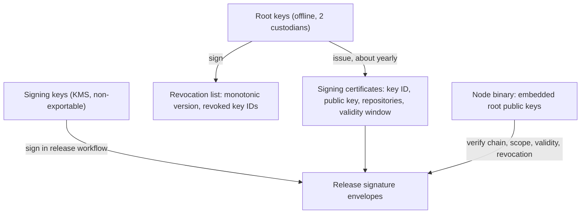

# RFC 0004: Fleet Node updates

- **Status**: draft
- **Author(s)**: Rongxin (@rl-block)
- **Created**: 2026-10-21
- **Last updated**: 2026-10-21

## Summary

Let an operator update Fleet Nodes from Fleet. Fleet sends a Node only an operation ID and an exact release version over the existing `ControlStream`. A small root-owned service on the Node, separate from the unprivileged Fleet Node daemon, obtains that release and verifies its release signature. It then installs the release with the existing transactional installer, which rolls back automatically if the new version doesn't start.

The release can come from three places:
- the Node's pinned release repository
- a directory an operator staged on the host
- Fleet, relaying a bundle it holds

Every release is signed by the release pipeline, so Fleet can relay bundles without being able to choose code that runs as root on Nodes. Signing uses offline root keys and short-lived signing certificates, so keys can be rotated, routinely or in an emergency, under a procedure defined up front. Fleet keeps durable records of every update request, transition, and outcome for audit and debugging.

This replaces the statement in [RFC 0001](0001-agent-server-split.md#fleet-node-updates) that self-update over the gateway is out of scope. It also delivers RFC 0001's planned signed Node release artifacts.

## Decision summary

| Area | Direction |
| ---- | --------- |
| Trigger | Fleet API, used first by the Nodes page, gated by `fleetnode:manage`. The host installer remains the manual path. |
| What Fleet sends | An operation ID and an exact version. When relaying, Fleet also sends the signed bundle. Never a URL, repository, or script. |
| Privilege boundary | A root, socket-activated `fleet-node-update` service. The Fleet Node daemon never gains root. |
| Delivery | HTTPS download from the Node's pinned repository, a root-owned staged directory on the host, or relay from Fleet. All three are verified the same way. |
| Signing | Offline root keys embedded in Node binaries issue short-lived signing certificates scoped to a repository. Signing keys are held in a KMS. A root-signed revocation list covers compromise. |
| Key rotation | Routine signing-key rotation needs no Node update. Root rotation overlaps two roots across releases. Both have documented emergency procedures. |
| Version policy | A semantic version newer than the running release, from the same repository. No downgrades, nightlies, or repository switches. |
| Support signal | A dedicated `ControlHello` field, not a new command protocol version. |
| Success | The installer succeeds and the Node reconnects reporting the target version. Otherwise the update is "unconfirmed" after a timeout. No automatic rollback beyond the installer's start-time rollback. |
| Pacing | Multi-Node requests update one Node at a time, stop at the first failure, and skip disconnected Nodes. Runs are stored in the database and resume after a Fleet restart or HA failover. |
| Records | Durable update, batch, and event records in Fleet's database; activity-log events for the organization's audit feed; and a bounded local history on each host. |

## Motivation

Today a Fleet Node is updated by signing in to its host and running `install-fleet-node.sh` for an exact release. Public documentation says "Fleet Node does not update itself." Internal deployments follow a runbook in which one person with repository access downloads a release and another person with host access installs it. Many Nodes sit behind NAT on customer or hosted networks, so there is no shared path from an operator's machine to every host. Fleet has no view of update progress and no record of who updated which Node, when, or to what.

Several building blocks now exist:

- `install-fleet-node.sh --release-dir DIR VERSION` installs operator-staged files with the same checksum, manifest, version, and repository checks and the same rollback as a download (block/proto-fleet#1108, synced into this repository).
- Node binaries embed their release version and publishing repository. They expose these through `fleetnode --version` and `fleetnode --print-release-repository`, and log them at startup (#229, #237).
- Nodes report their version on heartbeats, and the Nodes page shows it (#229).
- Fleet already shows "upgrade recommended" and "upgrade required" for Nodes behind the server's command protocol, but it can't act on that.

Internal deployments are the main Fleet Node users, and their releases come from a private repository that Nodes can't download from. Without signed releases relayed by Fleet, each internal update would still need someone to stage files on every host.

The goals follow the acceptance criteria of the public issue (block/proto-fleet#1104), plus an audit requirement:

1. A repeatable way to update Fleet Nodes to a selected release.
2. Reporting of update progress, failures, and the version running after each update.
3. Documentation of the update workflow and of recovery from a failed update.
4. A durable record of every update for audit and debugging.

Non-goals:
- zero-downtime replacement (the warm-standby design in RFC 0001 Phase 6 isn't built)
- updating plugins on their own
- Windows and Docker development Nodes
- repository switches and downgrades
- updates that start without an operator request

## Detailed design

### Flow

```mermaid
sequenceDiagram
  participant O as Operator
  participant F as Fleet
  participant D as Fleet Node daemon
  participant X as Update executor (root)
  participant S as Release source
  O->>F: UpdateFleetNodes(nodes, version)
  F->>F: Record the batch and operations; check each Node
  F->>D: AgentCommand.update_node(operation_id, version, revocation list)
  D->>X: Request over local socket
  X-->>D: Accepted, or rejected with a reason
  D-->>F: ControlAck (recorded)
  X->>S: Fetch archive, checksum, and signature (or receive a relay from Fleet)
  X->>X: Verify signature, checksum, version, and repository
  X->>D: Archive's installer stops the old daemon
  Note over X: Installer starts the new daemon, waits for READY, rolls back on failure
  D-->>F: Heartbeats carry phase changes while the old daemon runs (recorded)
  D->>F: New daemon's ControlHello reports version and final status
  F->>F: Record the outcome, write activity events, start the next Node
```

### Release identity

Phase 1 builds on the identity that already exists:
- the stamped `main.version` and `releaseinfo.Repository`
- the heartbeat `version` field
- the version shown on the Nodes page

The heartbeat value stays the display source for disconnected Nodes. `ControlHello` also carries the version and repository so that Fleet's checks at dispatch time use the identity of the live connection. A heartbeat-persisted value can lag a reconnect by up to one heartbeat interval.

### Release signing

**What is signed.** For each Node archive, the release pipeline produces `fleetnode-<version>-linux-<arch>.tar.gz.sig`. It's a DSSE-style envelope: a typed payload plus signatures, so no JSON canonicalization is needed. The payload is a statement:

```json
{
  "type": "proto-fleet/fleet-node-release/v1",
  "artifact": "fleetnode-v0.6.0-linux-arm64.tar.gz",
  "sha256": "<archive digest>",
  "version": "v0.6.0",
  "release_repository": "block/proto-fleet",
  "arch": "arm64"
}
```

Binding the version and repository into the statement stops a signed archive being replayed as a different version, or into another repository's Nodes. Each envelope carries its signing certificate, so verification needs no network access.

**Key hierarchy.**



- **Root keys.** Each root key is held offline by two custodians, for example on hardware tokens. They're used only in short signing ceremonies to issue signing certificates and revocation lists. Each Node release embeds a keyring of one or two root public keys at build time, the same way it embeds `releaseinfo.Repository`.
- **Signing keys.** Signing keys live in a cloud KMS and are never exported. The release workflow reaches them through GitHub OIDC, restricted to release and nightly workflows on protected refs. Algorithm: Ed25519 where the KMS supports it, otherwise ECDSA P-256. Both verify with the Go standard library, so the Node needs no new dependency.
- **Signing certificates.** Each certificate names its key ID, public key, the repositories it may sign for, and a validity window of about 13 months. The root key signs it. The repository scope means an internal signing key can't sign releases for public Nodes, and the reverse.
- **Revocation list.** A small root-signed document carrying a monotonic version and the revoked signing key IDs. Each release attaches the current list, and Fleet sends it with every update command. A Node keeps the highest-versioned list it has seen and never accepts an older one.

**Verification.** The executor verifies every release before installing it, whichever source the release came from. It checks that:
- the certificate chains to a root in the Node's keyring
- the certificate is within its validity window at the Node's current time
- the certificate's scope includes the Node's pinned repository
- the key isn't revoked
- the signature covers the statement
- the statement's digest, version, repository, and architecture match the archive and the request

Fleet runs the same verification when it ingests a bundle, so mistakes surface early, but Nodes never rely on Fleet having checked. Releases that predate signing can't be installed through the executor.

**Manual installs.** `install-fleet-node.sh` keeps its current checksum and repository checks. When an existing installation's binary supports it, the installer also verifies the new release with `fleetnode release verify` from the *installed* binary before replacing it. Fresh installs keep HTTPS and the checksum as their trust anchor.

### Key rotation

| Event | Procedure | Node impact |
| ----- | --------- | ----------- |
| Routine signing-key rotation (yearly, or when custodians or KMS settings change) | Create a new KMS key. Hold a root ceremony to issue its certificate, then switch the pipeline. Before the old certificate expires, re-sign all supported releases with the new key. Signature files are separate release assets, so archives and checksums don't change. | None. |
| Signing-key compromise | 1. Turn off relay and bundle ingest in Fleet. 2. Root custodians publish a revocation list naming the key. 3. Issue a new signing key and certificate. 4. Re-sign supported releases. 5. Turn relay back on. 6. Use the durable records to list every update installed under the revoked key, and review those Nodes. | Nodes reject the revoked key from their next update command, because every command carries Fleet's current list and the executor adopts a newer list before verifying. A Node installs nothing through the executor without a command, so idle Nodes are covered too. Releases also attach the list for manual installs. |
| Planned root rotation (every few years, or when custodians change) | 1. Release N embeds the old and new root keys. 2. Once Fleet reports that every active Node trusts the new root, issue certificates only from it. 3. A later release drops the old root. | One ordinary update, to release N or later. Fleet blocks relayed releases signed only under the new root for Nodes that don't trust it yet, and shows them as needing an update. |
| Root compromise | Turn off relay. Publish a release embedding a new root, signed under it, and install it manually on each Node through the installer's HTTPS download or a staged directory. Turn relay back on per Node once it reports the new root. | A manual update on every Node. Offline custody and the narrow ceremony scope keep this unlikely. |

`ControlHello` reports each Node's trusted root key IDs and revocation list version, so Fleet can show which Nodes are ready for a rotation before it starts. Certificate checks depend on the Node's clock, which must already be correct for authentication; a clock error is reported as a signature failure with the reason. Every signing ceremony and rotation is recorded in a runbook kept alongside the release workflow. At least one rotation drill runs in CI before phase 1 ships.

### Update executor

**Packaging.** The Node archive gains three files:
- a repository-stamped `install-fleet-node.sh`, covered by the archive checksum and signature
- `fleet-node-update.socket`
- `fleet-node-update.service`

The installer's manifest allowlist accepts them. Install, rollback, and uninstall handle the two units, and installation enables the socket. Older installers reject archives with the new files, which only matters when someone runs an old installer against a new release. The documented manual flow always uses the target release's own installer.

**Units.**
- **Socket:** `fleet-node-update.socket` listens on `/run/fleetnode-update/update.sock` with `SocketUser=root`, `SocketGroup=fleetnode`, and `SocketMode=0660`.
- **Service:** `fleet-node-update.service` runs `fleetnode update-executor` as root, outside `fleet-node.service`. That matters because the installer stops `fleet-node.service`. The service exits when idle.
- **Daemon unit:** unchanged. Its existing `AF_UNIX` allowance should be enough to connect to the socket; native qualification must confirm this under `ProtectSystem=strict`.

**Requests.** One JSON object per connection, at most 64 KiB. It contains:
- the operation ID
- the target version
- optionally, Fleet's current revocation list

When Fleet relays the release, the daemon first downloads the bundle into its spool directory through `DownloadCommandArtifact`. It then passes the executor open file descriptors for the archive, checksum, and signature. The executor copies them into its private directory before verifying anything, so the daemon can't change the files between verification and installation. The executor never reads a URL, path, repository, or command from a request. It accepts a request only when all of these hold:

- `operation_id` is a canonical UUID.
- `target_version` matches the installer's tag grammar, is a valid semantic version, and is newer than the installed `/opt/fleetnode/version.txt`. Nightly tags aren't semantic versions, so they're rejected.
- The installed `version.txt`, the installed binary's embedded repository, and `/etc/fleetnode/release-repository` (when present) all name the same repository. A mismatch is reported as `REPOSITORY_MISMATCH`.
- No other operation is active. Repeating an operation ID returns that operation's current status rather than starting a new one.

**Release sources.** The executor uses exactly one source per operation and never falls back to another:
- **Relay:** used when Fleet sends the bundle with the command.
- **Staged directory:** used when a root-owned drop-in sets `FLEETNODE_UPDATE_RELEASE_DIR`. The executor reads `<dir>/<version>/` under the installer's full-path rules. Because root reads them, the directory and files must also be owned by root.
- **Download:** otherwise, it downloads from the pinned repository's GitHub release over HTTPS, with redirects restricted to HTTPS and bounded time and size.

Every source supplies the archive, its `.sha256`, and its `.sig`.

**Installation.** The executor:
1. Verifies the signature as described under *Release signing*.
2. Checks that the checksum file names the archive, verifies the checksum, and extracts the archive into a private, root-only directory.
3. Confirms the archive's `version.txt` matches the signed statement.
4. Runs the archive's own installer with `--release-dir` pointing at a private copy.

The installer then performs its existing transactional replacement: stop, replace, start, wait for systemd readiness, and roll back on failure.

**Status and local history.** `/var/lib/fleetnode-update/status.json` lives in a root-owned `0755` directory as a `0644` file, so the daemon can read it but not write it. It records:
- operation ID
- target version
- previous version
- source
- archive digest
- signing key ID
- phase
- error
- timestamps
- outcome revision

The phases reuse `instance.v1.UpgradePhase` names: `QUEUED`, `DOWNLOADING`, `VERIFYING`, `STAGING`, `ACTIVATING`, `SUCCEEDED`, and `FAILED`, plus `ROLLED_BACK`. On startup, the executor reconciles an operation interrupted in `ACTIVATING` from the installed `version.txt`.

Each finished operation is also appended to `/var/lib/fleetnode-update/history.jsonl`, which keeps the most recent 200 entries, and logged to the journal. This lets someone on the host debug an update even when Fleet is unreachable. The revocation list is stored beside them as `revocations.json`.

**Bootstrap.** A Node running a release without the executor needs one manual update to a signed release that has it.

### Gateway contract

```proto
message ControlHello {
  CommandProtocolVersion max_command_protocol_version = 1;
  // Running binary's release version and publishing repository.
  string version = 2 [(buf.validate.field).string.max_len = 128];
  string release_repository = 3 [(buf.validate.field).string.max_len = 140];
  NodeUpdateState update = 4;
}

message NodeUpdateState {
  // True only when the root update executor is installed and reachable.
  bool executor_available = 1;
  NodeUpdateUnavailableReason unavailable_reason = 2;
  NodeUpdateOperation last_operation = 3;
  repeated string trusted_root_key_ids = 4;
  uint64 revocation_list_version = 5;
}

message NodeUpdateOperation {
  string operation_id = 1;
  string target_version = 2;
  string previous_version = 3;
  NodeUpdatePhase phase = 4;
  string error = 5;
  NodeUpdateSource source = 6;
  string artifact_sha256 = 7;
  string signing_key_id = 8;
  uint64 outcome_revision = 9;
  google.protobuf.Timestamp started_at = 10;
  google.protobuf.Timestamp updated_at = 11;
  google.protobuf.Timestamp completed_at = 12;
}

message UpdateFleetNodeRequest {
  string operation_id = 1 [(buf.validate.field).string.uuid = true];
  string target_version = 2 [(buf.validate.field).string = {min_len: 1, max_len: 128}];
  // Root-signed revocation list; the Node keeps the highest version it has verified.
  bytes revocation_list = 3 [(buf.validate.field).bytes.max_len = 65536];
  // Present when Fleet relays the release; the bundle is fetched with DownloadCommandArtifact.
  RelayedRelease relay = 4;
}

message RelayedRelease {
  CommandArtifactRef archive = 1;
  CommandArtifactRef checksum = 2;
  CommandArtifactRef signature = 3;
}

// New AgentCommand arm.
//   UpdateFleetNodeRequest update_node = 6;

// New CommandArtifactPurpose value, admitted only for an in-flight update_node command.
//   COMMAND_ARTIFACT_PURPOSE_FLEET_NODE_RELEASE = 3;

// New UploadHeartbeatRequest field: the active operation while the old daemon runs.
//   NodeUpdateOperation update = 4;
```

The daemon validates the command, downloads any relayed bundle, forwards the request to the executor socket, and acknowledges it once the executor accepts or rejects it. A rejection maps to an existing `AckCode` with the executor's reason. Fleet dispatches only to connections whose `ControlHello` reports `executor_available` and trust in the root that issued the target release's signing certificate. Every command carries Fleet's current revocation list, and the executor adopts it before verifying when it's newer than the list the Node holds. The command protocol enum is unchanged: update support depends on whether the executor is installed, not only on daemon code, and keeping it off the enum leaves that enum to miner commands.

### Fleet release store

Fleet keeps signed Node bundles in its existing file storage, the same area that holds miner firmware uploads. Bundles can arrive three ways:
- downloaded automatically from Fleet's own release repository when that repository is public
- uploaded by an operator through the API or UI, for example after downloading a private release with their own GitHub credentials
- read from a staged directory on the Fleet host, which automated deployments such as the cloud release pipeline can fill

Fleet verifies each bundle on ingest and records who supplied it. The ingest API is gated by `fleetnode:manage`.

### Update records

Fleet keeps durable records in three tables, added by an internal migration that requires shared baseline 1000. Batches are stored even for a single Node, so every operation has the same shape.

```sql
CREATE TABLE fleet_node_update_batch (
  id uuid PRIMARY KEY,
  org_id bigint NOT NULL,
  requested_by bigint REFERENCES "user"(id),
  target_version text NOT NULL,
  status text NOT NULL,            -- running, completed, stopped, canceled
  created_at timestamptz NOT NULL,
  updated_at timestamptz NOT NULL,
  completed_at timestamptz
);

CREATE TABLE fleet_node_update (
  operation_id uuid PRIMARY KEY,
  org_id bigint NOT NULL,
  fleet_node_id bigint NOT NULL,
  batch_id uuid NOT NULL REFERENCES fleet_node_update_batch(id),
  position integer NOT NULL,
  target_version text NOT NULL,
  previous_version text,
  release_repository text NOT NULL,
  source text,                     -- relay, staged, download
  artifact_sha256 text,
  signing_key_id text,
  revocation_list_version bigint,
  status text NOT NULL,            -- pending, dispatched, in_progress, succeeded, failed,
                                   -- rolled_back, unconfirmed, rejected, skipped, canceled
  phase text,
  error_code text,
  error_message text,
  reported_version text,
  node_outcome_revision bigint,
  created_at timestamptz NOT NULL,
  updated_at timestamptz NOT NULL,
  completed_at timestamptz,
  CONSTRAINT fk_fleet_node_update_node FOREIGN KEY (fleet_node_id, org_id) REFERENCES fleet_node(id, org_id)
);

CREATE TABLE fleet_node_update_event (
  id bigserial PRIMARY KEY,
  operation_id uuid NOT NULL REFERENCES fleet_node_update(operation_id),
  org_id bigint NOT NULL,
  occurred_at timestamptz NOT NULL,
  origin text NOT NULL,            -- fleet, node
  status text NOT NULL,
  phase text,
  message text,
  details jsonb                    -- bounded, never credentials
);
```

- **Writes.** Fleet records the batch and every operation before it dispatches anything. It appends an event for each transition: dispatch, acknowledgement, every phase from heartbeats, reconnect, and the final outcome. Writes are idempotent on operation ID and the Node's outcome revision. The Node's status file stays authoritative for what happened on the host: on reconnect, Fleet reconciles any outcome it missed, for example after a Fleet restart.
- **Retention.** Records are kept when a Node is revoked or deleted. Fleet Nodes are soft-deleted, and the tables never cascade deletes. Operations and events are kept indefinitely in phase 1; a pruning policy can follow if volume requires it.
- **Audit feed.** Fleet also writes `fleet_node_update.requested` and `fleet_node_update.completed` activity-log events, using the batch ID the activity log already supports. Update activity then appears alongside other operator actions, and the detailed records hold the timeline.
- **Access.** `ListFleetNodeUpdates` (by Node, batch, or time range) and `GetFleetNodeUpdate` (an operation with its events) are gated by `fleetnode:read`. Records never contain credentials or bundle contents.

### Fleet API and UI

`FleetNodeAdminService.UpdateFleetNodes` takes Node IDs and an exact target version, and returns the batch ID with an operation ID for each Node. It's gated by `fleetnode:manage`. For each Node, Fleet requires:
- an active `ControlStream`
- `executor_available`
- a `release_repository` that equals Fleet's own `releaseinfo.Repository`
- a target newer than the Node's running version
- trust in the target release's signing root
- a signed bundle in the release store whenever relay will be used

A Node that fails a check is recorded as `rejected` with the reason. The UI defaults the target to Fleet's own version, and operators can choose another exact tag.

`ListFleetNodes` adds `update_available`, `update_unavailable_reason`, and the latest operation, using `FleetNodeSummary` field numbers 16 and above.

**Pacing.** The batch runner runs on the active Fleet instance and updates one Node at a time:
- The next Node starts only after the previous one succeeds.
- The run stops at the first failed or unconfirmed Node.
- A Node that is disconnected when its turn comes is recorded as `skipped`.

Because batches and operations are stored, a new active instance resumes a running batch after a restart or HA failover. Operation IDs are created when the batch is recorded, so a resumed dispatch can't start a second update on a Node.

**Outcomes.**
- **Succeeded:** the Node reconnects with `ControlHello.version` equal to the target and `last_operation.phase` of `SUCCEEDED`.
- **Failed:** the Node reports `FAILED` or `ROLLED_BACK`.
- **Unconfirmed:** the Node doesn't reconnect within 10 minutes of `ACTIVATING`.

**UI.**
- **Nodes page:** a row action and multi-select. The confirmation names the target version and warns about the short telemetry and command gap.
- **Progress:** shows the current phase.
- **Failures:** show the error, the recovery command, and `journalctl -u fleet-node-update.service`.
- **History:** each Node's details include its update history from the durable records. A batch view shows each Node's position and outcome.

### Repository pin repair

Nodes updated with the earlier manual internal procedure have an internal `version.txt` and a public `release-repository` pin. The executor reports `REPOSITORY_MISMATCH` for them.

A new installer action, `install-fleet-node.sh repair-repository-pin`, rewrites the pin only when the installed `version.txt` and the installed binary both name the installer's packaged repository. It never changes the installed program. Moving a Node from public to internal releases remains a planned maintenance procedure.

### Security

- **Compromised Fleet.** It can relay only releases the pipeline signed, newer than each Node's version, for that Node's repository. It can't run arbitrary code. Because versions only move forward, it can cause at most a finite number of restarts. It can't roll back a Node's revocation list.
- **Compromised signing key.** On its own, it has no way to deliver a release. An attacker also needs GitHub release write access, a compromised Fleet, or root on the host. Non-exportable KMS keys, OIDC limited to release workflows, certificates of about 13 months, and revocation all bound the exposure. The durable records identify every Node that installed a release signed with the key.
- **Compromised root key.** This is the worst case and needs manual reinstallation (see *Key rotation*). Offline custody by two people and ceremony-only use keep it unlikely.
- **Untrusted input.** The executor caps request size, parses requests strictly, never invokes a shell with request data, and takes no paths or URLs from requests. Status and history are written only to root-owned locations.
- **Credential isolation.** Verifying before installing preserves RFC 0001's credential isolation: Fleet never gets a way to run code that could read a Node's credential key.

### Failure behavior

| Situation | Result | Recovery |
| --------- | ------ | -------- |
| Bundle missing, signature invalid, key revoked, certificate expired, or root not trusted | `FAILED` with `SIGNATURE_INVALID` and the reason, before the service stops | Re-sign the release, update the revocation list, fix the Node's clock, or update the Node manually to a release trusting the new root |
| Download, staging, relay, or checksum fails | `FAILED` before the service stops; nothing changes | Fix the source and retry with a new operation ID |
| New version doesn't start | Installer rolls back; `ROLLED_BACK`; previous version running | Inspect the logs and history; choose another release |
| Rollback also fails | `FAILED` with the rollback error; the Node may be down | On the host, install the previous release with `--release-dir` |
| Starts but doesn't reconnect | `UNCONFIRMED` | Inspect the host journal and history; reinstall the previous release |
| Executor or host restarts mid-update | Executor reconciles the status from `version.txt` on its next start | None, or as above |
| Fleet restarts during a batch | A new active instance resumes the batch; Fleet reconciles missed outcomes when Nodes reconnect | None |

### Validation gates

- **Signing:**
  - tampered archive, wrong repository scope, wrong architecture, and version mismatch
  - expired and not-yet-valid certificates, revoked key, unknown root, and an older revocation list
  - a CI rotation drill that signs with a second key and later a second root
- **Executor:** unit tests for request parsing, version policy, repository checks, status, and history.
- **Installer harness:** the new units, the manifest allowlist, and verification with the installed binary.
- **Native qualification (amd64 and arm64):**
  - install signed release N, then update to N+1 through the socket from each source
  - inject a broken candidate and expect `ROLLED_BACK`
  - interrupt the executor and expect reconciliation
- **Database:** migration tests; idempotent record writes; a batch resuming after a simulated failover.
- **Fleet:** gateway, registry, release store, and admin handler tests, including permissions, plus Nodes page and history tests.
- **Manual:** a physical Raspberry Pi and an amd64 VM, using each source, through the Nodes page.

## Drawbacks

- **More root code:** every Node gets a root component to secure and maintain.
- **Key operations:** root custody, ceremonies, KMS configuration in two repositories, re-signing before certificates expire, and rotation drills are ongoing work.
- **Clock dependency:** certificate checks need a correct clock on the Node.
- **Bootstrap:** existing Nodes need one manual update to the first signed release with the executor.
- **Downtime:** each update interrupts telemetry and commands for that Node's miners briefly.
- **Migration:** a new migration and records that are kept indefinitely; bundle storage on Fleet hosts is about 45 MiB per release and architecture.

## Alternatives considered

- **Operator tooling only** (SSH scripts around the installer). It can't reach Nodes behind NAT, gives no central progress, and keeps no audit trail.
- **The daemon replaces itself.** This needs write access to `/opt/fleetnode` and service control for the `fleetnode` user, undoing its hardening.
- **Fleet relays unsigned bundles.** Fleet would choose code that runs as root on every Node.
- **One long-lived signing key embedded in Nodes.** Every rotation needs a coordinated Node update, and recovering from a compromise is slow.
- **Sigstore keyless signing with the public transparency log.** Internal repository identities and artifact digests would be published publicly. Nodes would also need a trust root that changes over time, plus offline inclusion proofs.
- **GitHub artifact attestations.** Verifying them needs GitHub's API or trust root, so Nodes without GitHub access can't check attestations for private repositories.
- **GitHub credentials on Nodes** for private releases. That puts long-lived credentials on hosts, which block/proto-fleet#1080 and the cloud deployment deliberately avoid.
- **Activity log as the only record.** It's a good audit feed but lacks structured per-operation state and phase timelines for debugging.
- **In-memory state only.** No audit trail, and batches are lost on restart.
- **Gate on `CommandProtocolVersion`.** Support depends on the installed executor, not only on daemon code. This repository and the public one also number protocol versions independently.
- **Reuse the firmware rollout engine.** It's built around miner release channels, model groups, and per-device provenance, which is far heavier than Nodes need.
- **Path-activated executor.** A daemon-writable request file gives no immediate accept or reject and invites symlink tricks.

## Unresolved questions

1. Key custody: which KMS holds the signing keys, which hardware holds the root keys, and who the root custodians are.
2. Roots: one Block root for both repositories with repository-scoped certificates, or a separate root for each repository?
3. Is a 13-month certificate lifetime with yearly rotation right?
4. Should pin repair be an installer action, or a documented manual fix?
5. Is 10 minutes the right unconfirmed timeout, and should a Node that never reconnects roll back automatically? The proposed default is no.
6. Should targets newer than Fleet's own version be allowed? The proposed default is yes, when an operator selects them.
7. How long should records be retained, and should events be pruned before operations?
8. Should `fleetcli` expose updates and history in phase 1?

## Phased rollout

- **Phase 0, done.**
  - **Goal:** safer manual updates and visible Node identity.
  - **Scope:** staged installs, plus version and repository identity with heartbeat version reporting.
  - **Behavior change:** operators can install without GitHub access and see Node versions on the Nodes page.
- **Phase 1a: signing.**
  - **Goal:** every release can be verified offline.
  - **Scope:** root ceremony and signing keys; signing in release and nightly workflows; the verification library and `fleetnode release verify`; revocation list publishing; the rotation runbook and CI drill. This can start immediately.
  - **Behavior change:** releases gain `.sig` assets, and the installer verifies upgrades with the installed binary when it can.
- **Phase 1b: executor.**
  - **Goal:** a local, privileged, verifying update path.
  - **Scope:** executor, units, packaging, installer changes, local history, and native qualification.
  - **Behavior change:** signed releases include the executor; nothing triggers it remotely yet.
- **Phase 1c: gateway and relay.**
  - **Goal:** Fleet can request updates and deliver bundles.
  - **Scope:** `ControlHello` identity, capability, and trust state; the `update_node` command; heartbeat progress; the release artifact purpose; the Fleet release store.
  - **Behavior change:** roll out Nodes first. Older Fleet versions ignore the new fields.
- **Phase 1d: records and UI.**
  - **Goal:** operator-facing, auditable updates.
  - **Scope:** the migration and records; the API, batch runner, and activity events; the Nodes page and history; documentation; the pin repair action.
  - **Behavior change:** operators update Nodes from Fleet and can audit every update.
- **Phase 2, optional.**
  - **Goal:** larger fleets.
  - **Scope:** maintenance windows, multi-site scheduling, and offering Node updates automatically when Fleet itself is upgraded.
  - **Behavior change:** to be decided.
