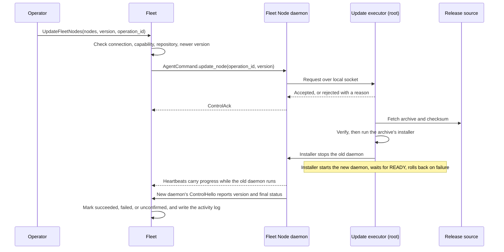

# RFC 0004: Fleet Node updates

- **Status**: draft
- **Author(s)**: Rongxin (@rl-block)
- **Created**: 2026-10-21
- **Last updated**: 2026-10-21

## Summary

Let an operator update Fleet Nodes from Fleet. Fleet sends a Node only an operation ID and an exact release version over the existing `ControlStream`. A small root-owned service on the Node, separate from the unprivileged Fleet Node daemon, obtains that release, verifies it, and installs it with the existing transactional installer. It gets the release from the Node's pinned release repository or from an operator-staged directory. If the new version doesn't start, the installer rolls back automatically. The Node records progress durably, and Fleet shows each update's phase, any failure, and the version the Node reports after it reconnects.

Fleet never chooses the bytes a Node installs. Relaying release bundles through Fleet is what makes internal releases zero-touch, and it waits for signed Node release artifacts in a later phase.

This replaces the statement in [RFC 0001](0001-agent-server-split.md#fleet-node-updates) that self-update over the gateway is out of scope.

## Decision summary

| Area | Direction |
| ---- | --------- |
| Trigger | Fleet API, used first by the Nodes page, gated by `fleetnode:manage`. The host installer remains the manual path. |
| What Fleet sends | An operation ID and an exact version. Never a URL, repository, script, or bytes. |
| Privilege boundary | A root, socket-activated `fleet-node-update` service. The Fleet Node daemon never gains root. |
| Delivery, phase 1 | HTTPS download from the Node's pinned repository, or a root-owned staged directory configured on the host. |
| Delivery, phase 2 | Fleet relays signed bundles; Nodes verify them with a release key embedded at build time. |
| Version policy | A semantic version newer than the running release, from the same repository. No downgrades, nightlies, or repository switches. |
| Support signal | A dedicated `ControlHello` field, not a new command protocol version. |
| Success | The installer succeeds and the Node reconnects reporting the target version. Otherwise the update is "unconfirmed" after a timeout. No automatic rollback beyond the installer's start-time rollback. |
| Pacing | Multi-Node requests update one Node at a time, stop at the first failure, and skip disconnected Nodes. Not durable across Fleet restarts in phase 1. |
| State | The Node's status file is authoritative. Fleet keeps per-connection state in memory and writes activity-log events. No database migration. |

## Motivation

Today a Fleet Node is updated by signing in to its host and running `install-fleet-node.sh` for an exact release. Public documentation says "Fleet Node does not update itself." Internal deployments follow a runbook in which one person with repository access downloads a release and another person with host access installs it. Many Nodes sit behind NAT on customer or hosted networks, so there is no shared path from an operator's machine to every host, and Fleet has no view of update progress.

Several building blocks now exist:

- `install-fleet-node.sh --release-dir DIR VERSION` installs operator-staged files with the same checksum, manifest, version, and repository checks and the same rollback as a download (block/proto-fleet#1108, synced into this repository).
- Node binaries embed their release version and publishing repository. They expose these through `fleetnode --version` and `fleetnode --print-release-repository`, and log them at startup (#229, #237).
- Nodes report their version on heartbeats, and the Nodes page shows it (#229).
- Fleet already shows "upgrade recommended" and "upgrade required" for Nodes behind the server's command protocol, but it can't act on that.

The goals follow the acceptance criteria of the public issue (block/proto-fleet#1104):

1. A repeatable way to update Fleet Nodes to a selected release.
2. Reporting of update progress, failures, and the version running after each update.
3. Documentation of the update workflow and of recovery from a failed update.

Non-goals:
- zero-downtime replacement (the warm-standby design in RFC 0001 Phase 6 isn't built)
- updating plugins on their own
- Windows and Docker development Nodes
- repository switches and downgrades
- updates that start without an operator request

## Detailed design

### Flow



### Release identity

Phase 1 builds on the identity that already exists:
- the stamped `main.version` and `releaseinfo.Repository`
- the heartbeat `version` field
- the version shown on the Nodes page

The heartbeat value stays the display source for disconnected Nodes. `ControlHello` also carries the version and repository so that Fleet's checks at dispatch time use the identity of the live connection. A heartbeat-persisted value can lag a reconnect by up to one heartbeat interval.

### Update executor

**Packaging.** The Node archive gains three files:
- a repository-stamped `install-fleet-node.sh`, covered by the archive checksum
- `fleet-node-update.socket`
- `fleet-node-update.service`

The installer's manifest allowlist accepts them. Install, rollback, and uninstall handle the two units, and installation enables the socket. Older installers reject archives with the new files, which only matters when someone runs an old installer against a new release. The documented manual flow always uses the target release's own installer.

**Units.**
- **Socket:** `fleet-node-update.socket` listens on `/run/fleetnode-update/update.sock` with `SocketUser=root`, `SocketGroup=fleetnode`, and `SocketMode=0660`.
- **Service:** `fleet-node-update.service` runs `fleetnode update-executor` as root, outside `fleet-node.service`. That matters because the installer stops `fleet-node.service`. The service exits when idle.
- **Daemon unit:** unchanged. Its existing `AF_UNIX` allowance should be enough to connect to the socket; native qualification must confirm this under `ProtectSystem=strict`.

**Requests.** One JSON object per connection, at most 4 KiB: `{"operation_id": "<uuid>", "target_version": "<tag>"}`. The executor never reads a URL, path, repository, or command from a request. It accepts a request only when all of these hold:

- `operation_id` is a canonical UUID.
- `target_version` matches the installer's tag grammar, is a valid semantic version, and is newer than the installed `/opt/fleetnode/version.txt`. Nightly tags aren't semantic versions, so they're rejected.
- The installed `version.txt`, the installed binary's embedded repository, and `/etc/fleetnode/release-repository` (when present) all name the same repository. A mismatch is reported as `REPOSITORY_MISMATCH`.
- No other operation is active. Repeating an operation ID returns that operation's current status rather than starting a new one.

**Release sources.** The executor uses exactly one source and never falls back to the other:
- **Staged directory:** used when a root-owned drop-in sets `FLEETNODE_UPDATE_RELEASE_DIR`. The executor reads `<dir>/<version>/fleetnode-<version>-linux-<arch>.tar.gz` and its `.sha256` under the installer's full-path rules. Because root reads them, the directory and files must also be owned by root.
- **Download:** otherwise, it downloads the same two files over HTTPS from the pinned repository's GitHub release, with redirects restricted to HTTPS and bounded time and size.

**Installation.** The executor:
1. Checks that the checksum file names the archive.
2. Verifies the checksum, then extracts the archive into a private, root-only directory.
3. Confirms the archive's `version.txt` matches the requested version and repository.
4. Runs the archive's own installer with `--release-dir` pointing at a private copy.

The installer then performs its existing transactional replacement: stop, replace, start, wait for systemd readiness, and roll back on failure.

**Status.** `/var/lib/fleetnode-update/status.json` lives in a root-owned `0755` directory as a `0644` file, so the daemon can read it but not write it. It records:
- operation ID
- target version
- previous version
- phase
- error
- timestamps
- outcome revision

The phases reuse `instance.v1.UpgradePhase` names: `QUEUED`, `DOWNLOADING`, `VERIFYING`, `STAGING`, `ACTIVATING`, `SUCCEEDED`, and `FAILED`, plus `ROLLED_BACK`. On startup, the executor reconciles an operation interrupted in `ACTIVATING` from the installed `version.txt`.

**Bootstrap.** A Node running a release without the executor needs one manual update to a release that has it.

### Gateway contract

```proto
message ControlHello {
  CommandProtocolVersion max_command_protocol_version = 1;
  // Running binary's release version and publishing repository.
  string version = 2 [(buf.validate.field).string.max_len = 128];
  string release_repository = 3 [(buf.validate.field).string.max_len = 140];
  NodeUpdateState update = 4;
}

message NodeUpdateState {
  // True only when the root update executor is installed and reachable.
  bool executor_available = 1;
  NodeUpdateUnavailableReason unavailable_reason = 2;
  NodeUpdateOperation last_operation = 3;
}

message NodeUpdateOperation {
  string operation_id = 1;
  string target_version = 2;
  string previous_version = 3;
  NodeUpdatePhase phase = 4;
  string error = 5;
  google.protobuf.Timestamp started_at = 6;
  google.protobuf.Timestamp updated_at = 7;
  google.protobuf.Timestamp completed_at = 8;
}

message UpdateFleetNodeRequest {
  string operation_id = 1 [(buf.validate.field).string.uuid = true];
  string target_version = 2 [(buf.validate.field).string = {min_len: 1, max_len: 128}];
}

// New AgentCommand arm.
//   UpdateFleetNodeRequest update_node = 6;

// New UploadHeartbeatRequest field: the active operation while the old daemon runs.
//   NodeUpdateOperation update = 4;
```

The daemon validates the command, forwards it to the executor socket, and acknowledges it once the executor accepts or rejects it. A rejection maps to an existing `AckCode` with the executor's reason. Fleet dispatches only to connections whose `ControlHello` reports `executor_available`; the command protocol enum is unchanged. Update support depends on whether the executor is installed, not only on daemon code, and keeping it off the protocol enum leaves that enum to miner commands.

### Fleet API and UI

`FleetNodeAdminService.UpdateFleetNodes` takes these inputs and is gated by `fleetnode:manage`:
- Node IDs
- an exact target version
- a caller-generated operation ID

For each Node, Fleet requires:
- an active `ControlStream`
- `executor_available`
- a `release_repository` that equals Fleet's own `releaseinfo.Repository`
- a target newer than the Node's running version

The UI defaults the target to Fleet's own version. Operators can enter another exact tag.

`ListFleetNodes` adds `update_available`, `update_unavailable_reason`, and the current `NodeUpdateOperation`, using `FleetNodeSummary` field numbers 16 and above. `update_available` means Fleet's version is newer than the Node's, the executor is available, and the repositories match.

**Pacing.** A multi-Node request runs on the active Fleet instance, one Node at a time:
- The next Node starts only after the previous one succeeds.
- The run stops at the first failed or unconfirmed Node.
- A Node that is disconnected when its turn comes is skipped.

The run lives in memory. A Fleet restart or HA failover ends it, and the remaining Nodes simply stay outdated in the UI.

**Outcomes.**
- **Succeeded:** the Node reconnects with `ControlHello.version` equal to the target and `last_operation.phase` of `SUCCEEDED`.
- **Failed:** the Node reports `FAILED` or `ROLLED_BACK`.
- **Unconfirmed:** the Node doesn't reconnect within 10 minutes of `ACTIVATING`.

Fleet writes `fleet_node_update_requested` and `fleet_node_update_completed` activity events.

**UI.** The Nodes page adds a row action and multi-select. The confirmation names the target version and warns about the short telemetry and command gap. Progress shows the current phase. A failure shows the error, the recovery command, and `journalctl -u fleet-node-update.service`.

### Repository pin repair

Nodes updated with the earlier manual internal procedure have an internal `version.txt` and a public `release-repository` pin. The executor reports `REPOSITORY_MISMATCH` for them.

A new installer action, `install-fleet-node.sh repair-repository-pin`, rewrites the pin only when the installed `version.txt` and the installed binary both name the installer's packaged repository. It never changes the installed program. Moving a Node from public to internal releases remains a planned maintenance procedure.

### Security

- **Bounded authority.** In phase 1, a compromised Fleet or a compromised daemon can request only published, newer releases from the pinned repository, or releases a root operator staged. It can't run arbitrary code. Because versions only move forward, it can cause at most a finite number of restarts.
- **Untrusted input.** The executor caps request size, parses requests strictly, never invokes a shell with request data, and takes no paths or URLs from requests. Status is written only to root-owned locations.
- **Staged files.** For the root executor, staged directories and files must be owned by root and follow the installer's full-path rules.
- **Relay needs signing.** Relaying unsigned bundles would let a compromised Fleet run code as root on every Node and read each Node's credential key, defeating the credential isolation in RFC 0001. Phase 2 therefore requires signatures:
  - an ed25519 release key per publishing repository
  - the private key held in CI secrets, and the public key embedded at build time
  - a signature covering the archive checksum, version, and repository, verified on the Node before installation

### Failure behavior

| Situation | Result | Recovery |
| --------- | ------ | -------- |
| Download, staging, or verification fails | `FAILED` before the service stops; nothing changes | Fix the source and retry with a new operation ID |
| New version doesn't start | Installer rolls back; `ROLLED_BACK`; previous version running | Inspect the logs; choose another release |
| Rollback also fails | `FAILED` with the rollback error; the Node may be down | On the host, install the previous release with `--release-dir` |
| Starts but doesn't reconnect | `UNCONFIRMED` | Inspect the host journal; reinstall the previous release |
| Executor or host restarts mid-update | Executor reconciles the status from `version.txt` on its next start | None, or as above |
| Fleet restarts during a multi-Node run | Remaining Nodes aren't started; Node state is unaffected | Start a new request |

### Validation gates

- **Unit tests:** request parsing, version policy, repository checks, and status persistence for the executor.
- **Installer harness:** the new units and the updated manifest allowlist.
- **Native qualification (amd64 and arm64):**
  - install release N, then update to N+1 through the socket from a staged directory
  - inject a broken candidate and expect `ROLLED_BACK`
  - interrupt the executor and expect reconciliation
- **Fleet tests:** gateway, registry, and admin handler tests, including permissions, plus Nodes page tests.
- **Manual:** a physical Raspberry Pi and an amd64 VM, using both download and staged sources, through the Nodes page.

## Drawbacks

- **More root code:** every Node gets a root component to secure and maintain.
- **Bootstrap:** existing Nodes need one manual update first.
- **Internal releases aren't zero-touch yet:** they still need staging on each host until phase 2.
- **Downtime:** each update interrupts telemetry and commands for that Node's miners briefly.
- **Non-durable runs:** multi-Node runs don't survive Fleet restarts.

## Alternatives considered

- **Operator tooling only** (SSH scripts around the installer). It can't reach Nodes behind NAT and gives no central progress.
- **The daemon replaces itself.** This needs write access to `/opt/fleetnode` and service control for the `fleetnode` user, undoing its hardening.
- **Fleet relays unsigned bundles.** Fleet would choose code that runs as root on every Node. Deferred until signing exists.
- **GitHub credentials on Nodes** for private releases. That puts long-lived credentials on hosts, which block/proto-fleet#1080 and the cloud deployment deliberately avoid.
- **Gate on `CommandProtocolVersion`.** Support depends on the installed executor, not only on daemon code. This repository and the public one also number protocol versions independently.
- **Reuse the firmware rollout engine.** It is built around miner release channels, model groups, and per-device provenance, which is far heavier than Nodes need.
- **Warm-standby replacement** from RFC 0001. It isn't built and would be a much larger project.
- **Path-activated executor.** A daemon-writable request file gives no immediate accept or reject and invites symlink tricks.

## Unresolved questions

1. Internal deployments are the main Fleet Node users. Should signing and relay move into phase 1?
2. Should pin repair be an installer action, or a documented manual fix?
3. Is 10 minutes the right unconfirmed timeout, and should a Node that never reconnects roll back automatically? The proposed default is no.
4. Should targets newer than Fleet's own version be allowed? The proposed default is yes, when an operator selects them.
5. Should `fleetcli` expose updates in phase 1?

## Phased rollout

- **Phase 0, done.**
  - **Goal:** safer manual updates and visible Node identity.
  - **Scope:** staged installs, plus version and repository identity with heartbeat version reporting.
  - **Behavior change:** operators can install without GitHub access and see Node versions on the Nodes page.
- **Phase 1a: executor.**
  - **Goal:** a local, privileged update path.
  - **Scope:** executor, units, packaging, installer changes, and native qualification. No Fleet changes.
  - **Behavior change:** releases include the executor; nothing triggers it remotely yet.
- **Phase 1b: gateway.**
  - **Goal:** Fleet can request updates.
  - **Scope:** `ControlHello` identity and capability, the `update_node` command, and heartbeat progress.
  - **Behavior change:** roll out Nodes first. Older Fleet versions ignore the new fields.
- **Phase 1c: Fleet.**
  - **Goal:** operator-facing updates.
  - **Scope:** API, pacing, activity events, the Nodes page, documentation, and the pin repair action.
  - **Behavior change:** operators update Nodes from Fleet.
- **Phase 2: signing and relay.**
  - **Goal:** zero-touch updates for private releases and hosts without GitHub access.
  - **Scope:** release signing in CI, Node verification, and Fleet-relayed bundles through `DownloadCommandArtifact`.
  - **Behavior change:** internal Nodes update without staging.
- **Phase 3, optional.**
  - **Goal:** larger fleets.
  - **Scope:** durable multi-site runs, and offering Node updates automatically when Fleet itself is upgraded.
  - **Behavior change:** to be decided.
