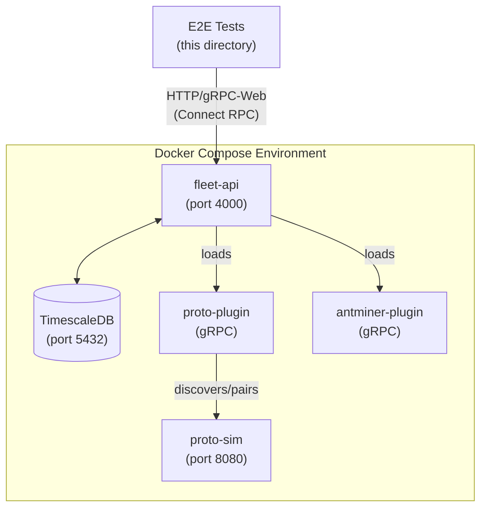

# E2E Testing Guide

This directory contains end-to-end (e2e) tests for the Proto Fleet system. These tests validate the complete plugin integration workflow using the real docker-compose infrastructure.

## Table of Contents

- [Overview](#overview)
- [Architecture](#architecture)
- [Test Categories](#test-categories)
- [Running Tests](#running-tests)
- [Test Workflows](#test-workflows)
- [Troubleshooting](#troubleshooting)

## Overview

The e2e tests validate that:

1. **Docker infrastructure** is properly configured and running
2. **Plugin system** loads and initializes correctly
3. **`fleetcli` commands** work against a real fleet-api

These tests run against the docker-compose environment that is already up (for example `just dev`), not isolated test infrastructure. The tests do not reset the environment. This ensures we're testing the real system as users would deploy it.

## Architecture

### System Under Test



### Test Architecture

The e2e tests follow a **system testing** approach:

- Tests interact with the real Fleet API at `http://localhost:4000` (set `FLEET_E2E_API_URL` to use a different address)
- Uses actual docker-compose services (not mocks or isolated infrastructure)
- Validates complete workflows through public API endpoints

**Key Design Principle**: Tests should interact with the system exactly as a real client would - through the Fleet API using Connect RPC (gRPC-Web).

## Test Categories

### 1. Infrastructure Validation (`TestPluginIntegration`)

Validates that the docker-compose environment is properly configured and all services are running correctly.

**What it tests**:

```
┌─────────────────────────────────────────────────────────────┐
│                   TestPluginIntegration                      │
│                                                              │
│  1. DockerContainersRunning                                 │
│     ├─ fleet-api container exists and is running           │
│     ├─ proto-sim container exists and is running           │
│     └─ timescaledb container exists and is running         │
│                                                              │
│  2. FleetAPIHealth                                          │
│     └─ /health/ready endpoint returns 200 OK               │
│                                                              │
│  3. PluginBinariesCorrect                                   │
│     ├─ proto-plugin binary exists                          │
│     ├─ antminer-plugin binary exists                       │
│     ├─ Binaries are ELF format (not Mach-O)               │
│     └─ Binaries are ARM64 architecture (for Docker)       │
│                                                              │
│  4. PluginsLoaded                                           │
│     ├─ Check fleet-api logs for plugin startup messages   │
│     ├─ Verify gRPC protocol is used                       │
│     └─ Ensure no plugin load errors                       │
│                                                              │
│  5. ProtoSimAccessible                                      │
│     └─ proto-sim container is running and has IP          │
│                                                              │
│  6. DatabaseConnectivity                                    │
│     ├─ Can connect to TimescaleDB                          │
│     └─ Required tables exist (device, user, etc.)         │
│                                                              │
│  7. AdminUserCreation                                       │
│     └─ Can create admin user via API                      │
│                                                              │
│  8. Authentication                                          │
│     └─ Can authenticate and receive JWT token             │
└─────────────────────────────────────────────────────────────┘
```

**Run this test**:
```bash
# Via just command (recommended)
just test-plugin-integration

# Or directly
go test -v -tags=e2e ./e2e -run TestPluginIntegration
```

### 2. `fleetcli` Commands (`TestFleetCLISubcommands`, `TestFleetCLIFirmwareWorkflow`)

These tests build the `fleetcli` binary and run its commands against the fleet-api at `http://localhost:4000`. They use the credentials from `FLEET_E2E_USERNAME` and `FLEET_E2E_PASSWORD` (defaults: `admin` and `proto`).

`TestFleetCLISubcommands` discovers and pairs the proto-sim miner first.

`TestFleetCLIFirmwareWorkflow` deletes all firmware files in its last step.

`TestFleetCLILeafCommandCoverage` reads the command manifest only. It does not need the docker-compose environment.

### 3. Fleet Node Release Channels (`TestFleetNodeReleaseChannelFirmware`)

This test updates firmware of devices that a Fleet Node owns, through a release channel. It uses the stack from `server/docker-compose.fleetnode-ui-test.yaml`: fleet-api, an enrolled Fleet Node, a fake Proto rig, and a fake CT1 HA pair. The fake devices are on an internal network that only the node joins.

The test does these steps through the public API:

1. Finds the connected node, discovers the rig and both controllers of the container through the node, and pairs them to the node.
2. Waits until Fleet shows telemetry for both devices.
3. Creates one channel for the two devices.
4. Uploads firmware with a version that is unique to the run, applies it, and waits for the rollout. It does this for rig firmware, CT1 hashboard firmware, and CT1 PSU firmware.
5. Updates the controller software of the container. It uploads a signed package with a version that is unique to the run, starts the update, and waits until the job succeeds. Then it reads the version of each controller from the update support.
6. Scans the node's network again and checks that the rig stays on target without a new rollout.

After each firmware rollout, the test reads the version from the device itself with `docker exec`.

Run it from the repository root. The recipe adds `server/docker-compose.fleetnode-channel-e2e.yaml`, which gives the stack its own host ports and fleet-network subnet. The overlay also sets `PROTO_MINER_PORT=0` on the node, so the node can discover the second controller of the fake CT1 on port 8082. With its own Compose project, the stack does not stop a `just dev` stack. The device network keeps the fixed subnet `10.90.0.0/24` of the UI-test overlay. Thus the recipe cannot run while a `just fleetnode-ui-test-up` stack is up (Docker reports `Pool overlaps`):

```bash
just fleetnode-channel-e2e            # project fnrc-e2e, API on 127.0.0.1:4611
just fleetnode-channel-e2e-down       # remove the containers, volumes, and release key
```

The test skips when `FLEET_E2E_FLEETNODE_COMPOSE_PROJECT` is not set. `FLEET_E2E_ROLLOUT_TIMEOUT` sets the wait for each rollout and for the controller software update (default `10m`).

The recipe makes an ECDSA P-256 release key in `/tmp/<project>-ct1-release-key`. The overlay gives the public key to the fake CT1. The test reads the private key from the file in `FLEET_E2E_CT1_RELEASE_KEY` and signs the package with it. Fleet in this stack has no installed release key, so the test sends the public key with the upload. The step `ContainerControllerSoftware` fails when `FLEET_E2E_CT1_RELEASE_KEY` is not set. `just fleetnode-channel-e2e-down` removes the key directory.

To run the test again against the same stack, run the `go test` command at the end of the recipe with the same environment variables. Use a fresh stack for a result that you report. In one of two runs on a used stack, the PSU firmware rollout did not complete. To run the recipe again, first run `just fleetnode-channel-e2e-down`. The recipe makes a new key on each run, and the fake CT1 trusts only the key that it read when it started.

## Running Tests

### Prerequisites

1. **Just installed**: Task runner for commands
2. **Docker running**: Docker Desktop or Docker daemon
3. **Go installed**: Go 1.21+ for running tests
4. **Hermit activated**: Run `./bin/activate-hermit` from repo root

### Quick Start

```bash
# From the server/ directory, with the docker-compose environment up

# Option 1: Run infrastructure validation
just test-plugin-integration

# Option 2: Run one test
go test -v -tags=e2e ./e2e -run TestFleetCLISubcommands

# Option 3: Run all e2e tests
go test -v -tags=e2e ./e2e
```

### Important Notes

**Build Tags**: All e2e tests use the `//go:build e2e` tag. You must include `-tags=e2e` when running tests:

```bash
# ❌ Won't find any tests
go test ./e2e

# ✅ Correctly runs e2e tests
go test -tags=e2e ./e2e
```

**Skipping in Short Mode**: Tests automatically skip when running `go test -short`:

```bash
# Skips e2e tests (fast unit tests only)
go test -short ./...
```

## Test Workflows

### Authentication Flow

All API requests (except health checks and onboarding) require authentication:

```
┌──────────────┐
│   Request    │
└──────┬───────┘
       │
       ▼
  Has "Authorization: Bearer <token>" header?
       │
       ├─ No ──► 401 Unauthorized
       │
       ▼ Yes
  Token valid?
       │
       ├─ No ──► 401 Unauthorized
       │
       ▼ Yes
  ┌────────────┐
  │  Process   │
  │  Request   │
  └────────────┘
```

**Getting a token**:

`Authenticate` starts a cookie session. It does not return a token. The helper `authenticateViaRealAPI` in `plugin_integration_test.go` logs in with a cookie-jar client, creates an API key, and returns the key.

```go
// 1. Log in and create an API key
token := authenticateViaRealAPI(t, ctx, testUsername, testPassword)

// 2. Use the API key in subsequent requests
req.Header().Set("Authorization", "Bearer "+token)
```

## Troubleshooting

### Common Issues

#### 1. "no Go files in /server/e2e"

**Cause**: Missing `-tags=e2e` flag

**Solution**:
```bash
# ❌ Wrong
go test ./e2e

# ✅ Correct
go test -tags=e2e ./e2e
```

#### 2. "connection refused" or "context deadline exceeded"

**Cause**: Docker containers not running or not healthy

**Solution**:
```bash
# Check container status
docker ps | grep server-

# Check fleet-api logs
docker logs server-fleet-api-1

# Restart environment
just rebuild-all
```

#### 3. "plugin binary should be ELF binary"

**Cause**: Plugin built for macOS instead of Linux (Docker container architecture)

**Solution**:
```bash
# Rebuild plugins for correct architecture
just build-plugins

# Verify architecture
file plugins/proto-plugin
# Should output: ELF 64-bit LSB executable, ARM aarch64
```

#### 4. "unsupported plugin protocol 'netrpc'"

**Cause**: Plugin using wrong protocol (old HashiCorp go-plugin default)

**Solution**: Ensure plugins use gRPC protocol. Check plugin initialization:

```go
// ✅ Correct - gRPC protocol
plugin.Serve(&plugin.ServeConfig{
    HandshakeConfig: Handshake,
    Plugins: map[string]plugin.Plugin{
        "discoverer": &plugins.GRPCDiscovererPlugin{Impl: discoverer},
        "pairer":     &plugins.GRPCPairerPlugin{Impl: pairer},
    },
    GRPCServer: plugin.DefaultGRPCServer, // Important!
})
```

#### 5. "Admin user already exists"

**Cause**: Re-running tests without clean environment (normal for TestPluginIntegration)

**Solution**: This is expected. TestPluginIntegration tests accept "already exists" errors. If you need a truly clean environment, run:

```bash
just rebuild-all
```

### Debugging Test Failures

#### View detailed test output

```bash
# Run with verbose output
go test -v -tags=e2e ./e2e -run TestPluginIntegration

# Save output to file
go test -v -tags=e2e ./e2e -run TestPluginIntegration 2>&1 | tee test-output.log
```

#### Check Docker logs

```bash
# Fleet API logs (most important)
docker logs server-fleet-api-1

# Proto-sim logs
docker logs server-proto-sim-1

# TimescaleDB logs
docker logs server-timescaledb-1

# All services
docker-compose logs
```

#### Verify network connectivity

```bash
# Check if proto-sim is accessible from host
curl http://localhost:8080/health

# Check if fleet-api is ready for product traffic
curl http://localhost:4000/health/ready

# Check container networking
docker exec server-fleet-api-1 ping server-proto-sim-1
```

#### Database inspection

```bash
# Interactive PostgreSQL shell
just db-shell

# Check discovered devices
docker exec server-timescaledb-1 psql -U fleet -d fleet -c "SELECT * FROM discovered_device;"

# Check paired devices
docker exec server-timescaledb-1 psql -U fleet -d fleet -c "SELECT * FROM device;"

# Check users
docker exec server-timescaledb-1 psql -U fleet -d fleet -c "SELECT * FROM \"user\";"
```

### Performance Tuning

If tests are running slowly:

1. **Run tests in parallel** (not currently implemented, but possible):
   ```bash
   go test -v -tags=e2e -parallel 2 ./e2e
   ```

2. **Use test caching**: Go caches passing tests by default. Only changed tests will re-run:
   ```bash
   # First run: Full execution
   go test -tags=e2e ./e2e

   # Second run: Cached (instant)
   go test -tags=e2e ./e2e
   ```

3. **Reduce the request timeout**: Edit test constants in `plugin_integration_test.go`:
   ```go
   const (
       requestTimeout = 5 * time.Second  // Reduce from 10s
   )
   ```

## Test Maintenance

### Adding New Tests

When adding new e2e tests, follow this pattern:

```go
//go:build e2e

package e2e

import (
    "context"
    "testing"

    "github.com/stretchr/testify/require"
)

func TestMyNewWorkflow(t *testing.T) {
    if testing.Short() {
        t.Skip("Skipping e2e test in short mode")
    }

    ctx := context.Background()

    // 1. Setup (authenticate, etc.)
    token := authenticateViaRealAPI(t, ctx, testUsername, testPassword)

    // 2. Execute workflow
    // ... your test logic ...

    // 3. Validate results
    require.NotEmpty(t, result, "should have results")
}
```

**Best practices**:

- Use `testing.Short()` guard to allow skipping in CI
- Use subtests (`t.Run()`) for logical groupings
- Always use `require` for assertions that should stop the test
- Use `assert` for non-critical validations
- Add descriptive log messages with `t.Logf()`
- Use constants for timeouts, URLs, credentials

### Updating Tests for API Changes

When API definitions change:

1. **Regenerate code**: `just gen` (regenerates proto bindings)
2. **Update test imports**: Check if proto package paths changed
3. **Update request/response handling**: Check for new required fields
4. **Run tests**: `go test -tags=e2e ./e2e` to catch compilation errors

### CI/CD Integration

These tests can be integrated into CI/CD pipelines:

```yaml
# Example GitHub Actions workflow
name: E2E Tests

on: [push, pull_request]

jobs:
  e2e:
    runs-on: ubuntu-latest
    steps:
      - uses: actions/checkout@v3

      - name: Set up Go
        uses: actions/setup-go@v4
        with:
          go-version: '1.21'

      - name: Install Just
        run: curl --proto '=https' --tlsv1.2 -sSf https://just.systems/install.sh | bash -s -- --to /usr/local/bin

      - name: Run E2E Tests
        run: |
          cd server
          just test-plugin-integration
```

## Reference

### API Endpoints Used

| Endpoint | Method | Purpose |
|----------|--------|---------|
| `/health/ready` | GET | Readiness check (no auth required) |
| `/onboarding.v1.OnboardingService/CreateAdminLogin` | POST | Create first admin user |
| `/auth.v1.AuthService/Authenticate` | POST | Get JWT token |
| `/pairing.v1.PairingService/Discover` | Stream | Discover mining devices |
| `/pairing.v1.PairingService/Pair` | POST | Pair discovered devices |

### Constants

```go
const (
    fleetAPIURL       = "http://localhost:4000"
    protoSimIP        = "127.0.0.1"  // localhost since test runs on host
    protoSimPort      = "8080"
    testUsername      = "admin"
    testPassword      = "proto"
    requestTimeout    = 10 * time.Second
    containerPrefix   = "server-"
)
```

### Docker Containers

| Container | Purpose | Exposed Port |
|-----------|---------|--------------|
| `server-fleet-api-1` | Fleet API service | 4000 |
| `server-proto-sim-1` | Simulated Proto miner | 8080 |
| `server-timescaledb-1` | TimescaleDB database | 5432 |

### Related Documentation

- **Server development**: `../README.md`
- **Plugin architecture**: `../internal/domain/pairing/plugin/README.md` (if exists)
- **API definitions**: `../../proto/`
- **Docker setup**: `../docker-compose.yml`

---

**Questions or issues?** Check the troubleshooting section above or review the test code in `plugin_integration_test.go`.
